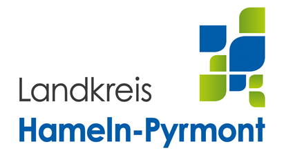

> Open-Source-Import: [Bereinigung, Konfiguration und Hinweise zur Git-Historie](docs/OPEN_SOURCE_PUBLICATION.md).

<div align="center">
  
  &emsp;&emsp;
  

 <h1>Kommunal App Hameln-Pyrmont</h1>

  <p>
    
    
    
    
    

  </p>

  <p width="80%">
    <b>The Hameln-Pyrmont Kommunal App</b> is a comprehensive digital ecosystem designed to connect the district administration with its citizens.
    It streamlines access to municipal services, simplifies administrative processes, and keeps the community informed through a modern mobile app and efficient backoffice tools.
  </p>
</div>

---

## 📚 Table of Contents
- [📁 Project structure](#project-structure)
- [🏗️ Tech Stack & Architecture](#-tech-stack--architecture)
- [🧠 Ask me anything](#-ask-me-anything)
- [🚀 Quick Start Guide](#-quick-start-guide)
  - [Prerequisites](#1-prerequisites)
  - [Install the tools](#2-install-the-tools)
    - [macOS](#macos)
    - [Windows (WSL 2)](#windows-wsl-2)
    - [Linux (Ubuntu)](#linux-ubuntu)
  - [First-time setup](#3-first-time-setup)
    - [Android app on Windows or Linux](#android-app-on-windows-or-linux)
  - [Task commands](#4-task-commands)
- [🐳 Local Docker Environment](#-local-docker-environment)
- [💾 Database Dumps](#-database-dumps)
- [💻 Component Guides](#-component-guides)
  - [🏭 Backend (.NET)](#-backend-net)
  - [🌐 Web Applications (React & CMS)](#-web-applications-react--cms)
  - [📱 Mobile App (Flutter)](#-mobile-app-flutter)
- [❓ Troubleshooting](#-troubleshooting)

---

## 📁 Project structure
The project is organized in a monorepo with the following structure.
```text

├── app/                # 📱 Mobile Application (Flutter)
├── backend/            # 🏭 Backend API (.NET 8)
├── web/                # 🌐 Web Monorepo (pnpm workspace)
│   ├── bereich-a/      #    - Backoffice Client (React)
│   ├── bereich-b/      #    - Headless CMS (Payload)
│   └── stele/          #    - Infostele Web App (React)
├── docker/             # 🐳 Infrastructure Configuration
├── Taskfile.yml        # ⚡ Task runner definitions
└── README.md           # 📄 You are here
```

---

## 🏗️ Tech Stack & Architecture

The project is built using a modern, scalable technology stack ensuring cross-platform compatibility and robust backend performance.

| Component | Technology | Description |
| :--- | :--- | :--- |
| **📱 Mobile App** | **Flutter** | Cross-platform citizen interface for news, waste collection, and requests. |
| **🌐 Backoffice** | **React** | Staff portal for request processing and management. |
| **📝 CMS** | **Payload CMS** | Headless CMS for managing app content and news. |
| **📺 Infostele** | **React + Vite** | Public info kiosk web app for digital info pillars. |
| **⚙️ Backend** | **.NET 8** | Core API and business logic, backed by PostgreSQL 15. |
| **🐳 Infra** | **Docker Compose** | Container orchestration for local development. |
| **🛡️ Proxy** | **Nginx & Certbot** | Reverse proxy and automated SSL certificate management. |

<br>

<div align="center">
  
</div>

---


## 🚀 Quick Start Guide

Follow these steps in order. They take a fresh machine to a running backoffice at http://localhost:3000 with seeded test users.

### 1. Prerequisites

| Tool | Version | Needed for |
| :--- | :--- | :--- |
| **Git** | any | everything |
| **Docker** with **Compose v2** (`docker compose`) | any recent | databases and infrastructure |
| **Task** (go-task) | 3.x | all project commands |
| **nvm** | any | installs Node from `.nvmrc` |
| **Node.js** | 22.14.0 (`.nvmrc`) | web apps, commit hooks |
| **pnpm** | 9.15.9 (via Corepack, pinned in `package.json`) | web dependencies |
| **.NET SDK** | 8.0 | backend |
| **openssl** | any | generating local secrets (preinstalled on macOS/Linux) |
| **FVM** + Flutter (version from `app/.fvmrc`) | – | mobile app only |
| **Xcode** + CocoaPods (macOS) or **Android Studio** | – | mobile app only |

You also need about 8 GB of RAM available for Docker.

### 2. Install the tools

#### macOS

1. Install [Homebrew](https://brew.sh), then the tools:

   ```bash
   brew install git go-task nvm colima docker docker-compose
   ```

2. Register the Compose plugin with the Docker CLI and start the Colima VM:

   ```bash
   mkdir -p ~/.docker/cli-plugins
   ln -sfn "$(brew --prefix)/opt/docker-compose/bin/docker-compose" ~/.docker/cli-plugins/docker-compose
   colima start --cpu 4 --memory 8
   docker compose version
   ```

   Colima does not start automatically after a reboot. Run `colima start` again, or use Docker Desktop instead.

3. Make `nvm` available in your shell (see [Troubleshooting](#-troubleshooting) if `nvm` is not found), then open a new terminal.
4. Install the [.NET 8 SDK](https://dotnet.microsoft.com/download/dotnet/8.0) and check it with `dotnet --list-sdks`.
5. Mobile app only: install Xcode from the App Store, then `brew install cocoapods` and `brew tap leoafarias/fvm && brew install fvm`.

#### Windows (WSL 2)

Run the backend, web apps and project tasks in Ubuntu under WSL 2. Run the Android toolchain and emulator on Windows.

1. In an administrator PowerShell, install [WSL 2 with Ubuntu](https://learn.microsoft.com/en-us/windows/wsl/install). Restart if prompted, then open Ubuntu and create your Linux user.

   ```powershell
   wsl --install -d Ubuntu
   ```

2. Start Docker Desktop, enable its [WSL 2 engine and Ubuntu integration](https://docs.docker.com/desktop/features/wsl/), then check `docker compose version` in Ubuntu.
3. Clone the repository inside the Ubuntu filesystem, for example under `~/projects`. Continue with the Linux steps below in the Ubuntu shell, skipping the Docker installation.
4. For mobile development, see [Android app on Windows or Linux](#android-app-on-windows-or-linux).

#### Linux (Ubuntu)

1. Install the base tools:

   ```bash
   sudo apt update
   sudo apt install git curl ca-certificates unzip xz-utils openssl
   ```

2. On native Ubuntu, install and start [Docker Engine with the Compose plugin](https://docs.docker.com/engine/install/ubuntu/). Make sure `docker info` and `docker compose version` work as your user without `sudo`.
3. Install the [.NET 8 SDK](https://learn.microsoft.com/en-us/dotnet/core/install/linux-ubuntu-install), [Task](https://taskfile.dev/docs/installation) and [nvm](https://github.com/nvm-sh/nvm#installing-and-updating), then open a new shell.

### 3. First-time setup

Run everything from the repository root.

1. **Node and pnpm.** Selects the Node version from `.nvmrc` and the pnpm version pinned in `package.json`, then installs the commit hooks:

   ```bash
   nvm install
   nvm use
   corepack enable pnpm
   task dev:setup
   ```

2. **CMS environment.** Create `web/bereich-b/.env`:

   ```bash
   task env:setup
   ```

   Then fill in these four values. Any random string works locally, for example the output of `openssl rand -hex 32`:

   | Variable | Purpose |
   | :--- | :--- |
   | `PAYLOAD_SECRET` | Signs CMS sessions |
   | `PAYLOAD_API_KEY` | Shared key between backend and CMS. `task backend` passes it to the backend as `BereichB__SuperAdminApiKey`. |
   | `PAYLOAD_SUPERADMIN_PASSWORD` | Password of the CMS technical admin created by the CMS seed |
   | `INTERNAL_API_SECRET` | Shared secret for the backoffice login into the CMS. `task backend` passes it to the backend as `BereichB__InternalApiSecret`. |

   The integration keys (`OPENWEATHER_API_KEY`, `MAPBOX_TOKEN`, …) can stay empty. `SKIP_IMPORTERS=true` turns off the external data imports.

3. **Backend seed secrets.** The backend seeder encrypts the test data with keys that must stay the same across restarts. Generate them once into `backend/API/.env` (gitignored). `task backend` loads that file automatically:

   ```bash
   task backend:seed-secrets
   ```

4. **LageHelfer seed data.** Development uses the bundled synthetic files in `backend/API/Seeders/LageHelfer/Data/example/` by default; no cloud access is required. The example backoffice login is `superadmin-beispiel@example.com` with the local-only password `123456`. Never use these public demo credentials on a hosted instance.

   For the hackathon KRL tenant, obtain the seed package and credentials separately from the event team and place the files in `backend/API/Seeders/LageHelfer/Data/krl/`. Set `DataSeeder__LageHelferSeedPath=Seeders/LageHelfer/Data/krl` in the gitignored `backend/API/.env`. Hosted credentials must not be committed.

   Then add the tenant to `web/bereich-b/.env`, using the `kommune` values from `seed.json`:

   ```bash
   ENABLE_LAGEHELFER_SEED=true
   LAGEHELFER_KOMMUNE_ID=<kommune.id>
   LAGEHELFER_KOMMUNE_NAME=<kommune.name>
   ```

5. **Start the containers:**

   ```bash
   task containers:up
   ```

6. **Seed the CMS.** This installs the web dependencies, runs the CMS migrations and creates the CMS base data:

   ```bash
   task web:install
   task web:bereich-b:seed
   ```

7. **Start the backend and web apps, seeding the backend on this first run:**

   ```bash
   DataSeeder__Enabled=true task start
   ```

   Later runs only need `task start`. These errors can appear during startup and can be ignored:

   - `fail: Quartz.Core.ErrorLogger[0]` and `Error: connect ECONNREFUSED 127.0.0.1:3001`, while the web apps are still starting.
   - `fail: Microsoft.EntityFrameworkCore.Database.Command[20102]` for `__EFMigrationsHistory` and `__EFMigrationsHistory_Archive`, on the first start against an empty database.

8. **Log in** at http://localhost:3000 with `superadmin-hapy@example.com` / `123456`.

Stop everything with `task stop`. It removes the containers of the Compose project configured in `docker/.env` (volumes and data are kept) and runs `kill -9` on every process on ports 3000–3003 and 5000, including ones from other checkouts and projects.

To use realistic data instead of the seed, see [💾 Database Dumps](#-database-dumps).

#### Android app on Windows or Linux

1. Install [FVM](https://fvm.app/documentation/getting-started/installation), then set up [Android Studio and the Android SDK](https://docs.flutter.dev/platform-integration/android/setup) on the host that will run the Android emulator. In Windows PowerShell or a native Linux terminal, run the following from `app/`. FVM reads the Flutter version from `app/.fvmrc`.

   ```text
   fvm install
   fvm flutter doctor --android-licenses
   fvm flutter doctor
   ```

2. Create `app/environments/config-development.json` as described in the [mobile app guide](#-mobile-app-flutter). Start an Android emulator or connect an Android phone with USB debugging enabled. With one device connected and Android SDK Platform Tools on your PATH, run the following from `app/`. [ADB reverse port forwarding](https://developer.android.com/develop/ui/views/layout/webapps/access-local-server) lets the device reach the local web proxy on port 3000.

   ```text
   fvm flutter devices
   adb reverse tcp:3000 tcp:3000
   fvm flutter pub get
   fvm dart run build_runner build
   fvm flutter run --flavor production --dart-define-from-file=environments/config-development.json
   ```

   The `production` Android flavor selects the Android build variant. The Dart defines load the local development configuration. iOS simulator development requires macOS.

### 4. Task commands
We use [Task](https://taskfile.dev) to automate developer workflows. Run `task --list` to see all available commands.

| Command | Description |
| :--- | :--- |
| `task start` | **Recommended:** Starts all infrastructure (Docker) and services. |
| `task stop` | Stops all infrastructure (Docker) and services. |
| `task containers:up` | Starts only the Docker containers (databases, Gotenberg, object storage, Keycloak). |
| `task containers:down` | Stops all Docker containers. |
| `task backend` | Starts the .NET Backend independently. |
| `task backend:seed-secrets` | Adds the backend seed secrets once to `backend/API/.env`. |
| `task web` | Starts the Web applications (Backoffice & CMS). |
| `task app:dev` | Starts the Flutter App. |
| `task db:update` | Imports database dumps for PostgreSQL and MongoDB. |
| `task commit` | **Recommended:** Formats staged files and starts an interactive commit guide. |
| `task c` | Alias for `task commit`. |
| `task docs:build` | Compiles the AsciiDoc documentation to HTML and PDF (requires Docker). |

> **ℹ️ Note:** The task commands only work if the setup was successful.

### 🛠️ Commit Workflow

We use a standardized commit workflow to ensure code quality and consistent formatting.

1.  **Stage your changes:** `git add .`
2.  **Commit using Task (Recommended):**
    ```bash
    task c
    ```
    This command runs an interactive guide to help you craft a conventional commit message and automatically runs formatters (Prettier, dotnet format, dart format) before committing.
3.  **Alternative:** You can still use `git commit`. Our Husky hooks will trigger the same formatting and linting checks to ensure consistency.

---

## 🐳 Local Docker Environment

The `docker-compose.local.yml` file spins up the necessary infrastructure services.

**Start Environment:**
```bash
task containers:up
# OR manually:
docker compose -f docker/docker-compose.local.yml up -d
```

**Services & Ports:**

The host ports below are defaults. `docker/.env` can override them (see [Changing ports and project name](#changing-ports-and-project-name)).

| Service | Host Port | Container Port | UI / Notes |
| :--- | :--- | :--- | :--- |
| **PostgreSQL** | `5432` | `5432` | Main Database |
| **PostgreSQL (archive)** | `5434` | `5432` | Archive Database |
| **MongoDB** | `27017` | `27017` | CMS Database |
| **Gotenberg** | `3002` | `3000` | PDF Generation Service |
| **Object storage (RustFS)** | `9000`, `9002` | `9000`, `9001` | S3 API and console; bucket `hameln-local` is created by `object-storage-init` |
| **Keycloak** | `8081`, `9001` | `8080`, `9000` | BundID identity broker (admin `admin` / `admin`) |

Keycloak starts without any extra files. The BundID login itself only works with the files described in `bundid-secrets/keycloak/README.md`.

#### Changing ports and project name

Copy `docker/.env.example` to `docker/.env` to change the host ports or the Compose project name, for example when a port is already taken. The project name prefixes container names, volumes and the network; a different name gives you a separate set of containers and data.

When you change a port, point the apps at it:

- **Backend:** add overrides to `backend/API/.env`, which `task backend` loads. Only set the ones you changed, for example:

  ```bash
  ConnectionStrings__Domain=Server=127.0.0.1;Port=5532;Database=db;UserId=admin;Password=password;Enlist=false
  ConnectionStrings__Archive=Server=127.0.0.1;Port=5534;Database=archive;UserId=archive;Password=archive-password;Enlist=false
  Gotenberg__Url=http://localhost:3102
  ObjectStorage__ServiceUrl=http://localhost:9100
  BundId__KeycloakAuthority=http://localhost:8181/realms/kommunalapp
  ```

  Prefer this file over `dotnet user-secrets`: user secrets are shared by every checkout of the project.
- **CMS:** change the MongoDB port in `DATABASE_URL` in `web/bereich-b/.env`.

The app ports (3000, 3001, 3003, 5000) are fixed, so only one checkout's apps can run at a time. A second stack in another checkout or worktree needs its own `docker/.env`, `backend/API/.env` overrides, `web/bereich-b/.env` and `task backend:seed-secrets`. Stop the other checkout's apps with Ctrl-C, not `task stop`.

---

## 💾 Database Dumps

This section explains how to import database dumps for local development, ensuring your local PostgreSQL and MongoDB instances are populated with relevant data.

**Staging / preprod (remote servers):** To refresh a server database from another environment’s scheduled backup using GitLab CI (including choosing a backup **date**), use the **`db:migration`** job; see the section *Database migration between environments* in [`ci/README.md`](ci/README.md).

> ⚠️ Note: Database dump files are not maintained in Git. Only synthetic or anonymized dumps may be used for local development.

#### 📥 Obtaining and Placing Dump Files

1.  **Download Dumps:** Create a synthetic database dump from an isolated development instance.
2.  **Extract & Place:** Extract the downloaded archive. You should find two files: `bereich-a.dump` (for PostgreSQL) and `bereich-b.dump` (for MongoDB).
3.  **Create Directory:** Create a new directory for the dumps within your project at `/dumps/<DATE>/`, where `<DATE>` is the date of the dump (e.g., `/dumps/20260211/`).
4.  **Move Files:** Place both `bereich-a.dump` and `bereich-b.dump` into the newly created directory (e.g., `/dumps/20260211/bereich-a.dump`).

#### 🚀 Importing Dumps

Once the dump files are in place, you can use the provided task command to import them into your local Dockerized databases.

1.  **Ensure Docker is Running:** Make sure your local Docker containers for PostgreSQL and MongoDB are running. You can start them with:
    ```bash
    task containers:up
    ```
2.  **Run Import Script:** Execute the following task command to import the dumps:
    ```bash
    task db:update
    ```
3.  **Sign In:** Use the credentials of a user included in the imported database dump. The seeded team lead account is available only if the dump contains the seed data.
    - User: `teamleiter-hapy@example.com`
    - Password: `123456`

This script will:
*   Verify the presence of the dump files.
*   Check if the PostgreSQL and MongoDB Docker containers are active.
*   Drop existing public schemas in PostgreSQL and restore `bereich-a.dump`.
*   Restore `bereich-b.dump` into MongoDB.

> ℹ️ Note: The script expects the dump files to be in the format `/dumps/<DATE>/bereich-a.dump` and `/dumps/<DATE>/bereich-b.dump`. If your dump files are named differently or located in a different subfolder, you might need to adjust the `DUMP_FOLDER_PATH` variable in [`scripts/use-database-dump.sh`](scripts/use-database-dump.sh:14).

---

## 💻 Component Guides

Detailed instructions for each part of the application stack.

### 🏭 Backend (.NET)
**Location:** `/backend`

Powers the Backoffice application and serves as the core API.

#### 🛠️ Setup
1.  **VSCode Extension**: Install the [C# Dev Kit](https://marketplace.visualstudio.com/items?itemName=ms-dotnettools.csdevkit).
2.  **CMS secrets**: `task backend` reads `PAYLOAD_API_KEY` and `INTERNAL_API_SECRET` from `web/bereich-b/.env` and passes them as the environment variables `BereichB__SuperAdminApiKey` and `BereichB__InternalApiSecret`, so every checkout uses its own values.
3.  **Push notifications (optional)**: Firebase push is disabled by default (`NoOpFirebasePushMessagingService` in `Program.cs`). To enable it, place a `kommunalapp-service-account.json` for your own Firebase project in `backend/API/` and follow the TODOs in `Program.cs`.

#### ⚙️ Configuration & Seeding
The seeder creates the Landkreis Hameln-Pyrmont Kommune and the backoffice users.

1.  Generate the seed secrets once: `task backend:seed-secrets`. Keep them in `backend/API/.env`: data seeded with one key set cannot be decrypted with another.
2.  Start the backend with seeding enabled: `DataSeeder__Enabled=true task backend`. To enable it permanently, set `DataSeeder.Enabled` to `true` in `backend/API/appsettings.Development.json`.

---

### 🌐 Web Applications (React & CMS)
**Location:** `/web`

Contains **Bereich A** (Backoffice), **Bereich B** (Payload CMS), and **Stele** (Infostele kiosk UI).

#### 🛠️ Setup
> **💡 Tip:** `task web` installs dependencies, runs the GraphQL codegen and starts the apps. It does not seed the CMS.

**Manual Steps:**
1.  **Install Dependencies:** `task web:install` (or `cd web && pnpm install`)
2.  **Environment Setup:** `task env:setup` (Copies `.env.example` to `.env` in `web/bereich-b`)
3.  **Seed CMS:** `task web:bereich-b:seed` (or `cd web/bereich-b && pnpm seed all`)
4.  **Run:** `task web` (or `cd web && pnpm dev`)

**Stele (optional):** See [`web/stele/README.md`](web/stele/README.md). Copy `web/stele/.env.example` to `.env`, set `VITE_KOMMUNE_ID`, ensure the backend is running, then `pnpm --filter stele dev` (port **3003**).

#### 🔑 Access

| Application | URL | Credentials |
| :--- | :--- | :--- |
| **Backoffice** | [http://localhost:3000](http://localhost:3000) | **User:** `superadmin-hapy@example.com`<br>**Pass:** `123456` |
| **CMS** | Via Backoffice | Login to Backoffice → Menu → 'Inhaltspflege' |
| **Stele (local)** | [http://localhost:3003](http://localhost:3003) | No login (public kiosk UI) |


#### 🔌 API Documentation
An OpenAPI 3.0 definition for the REST API of the CMS is available at: `web/bereich-a/src/routes/api-docs/openapi.json`. This can be used to test the available cms API endpoints.

**Integrate with [Bruno](https://www.usebruno.com/):**
1.  Open Bruno → Import Collection.
2.  Select "OpenAPI V3".
3.  Select `web/bereich-a/src/routes/api-docs/openapi.json`.
4.  Set the **apiKey** variable to your `PAYLOAD_API_KEY` to make authorized requests.

---

### 📱 Mobile App (Flutter)
**Location:** `/app`

#### 🚀 Get started
1.  **Environment Configuration**: create `app/environments/config-development.json` (gitignored):
    ```json
    {
      "BACKEND_URL": "http://localhost:3000",
      "KOMMUNE_ID": "5a1aefef-809f-403d-a14c-27051353c7d4",
      "MAPBOX_TOKEN": "",
      "MAPBOX_BBOX": ""
    }
    ```
    `KOMMUNE_ID` is the seeded Landkreis Hameln-Pyrmont. Maps need your own [Mapbox](https://www.mapbox.com) token.
2.  **Firebase**: the app builds need your own Firebase configuration at the paths of the `google-services.json.example` / `GoogleService-Info.plist.example` files in `app/android` and `app/ios`.
3.  **Install Dependencies and generate code**:
    ```bash
    task app:gen
    ```
4.  **iOS Setup (Mac Only):** Required if it's your first time running a flutter app on the iOS Simulator.
    ```bash
    cd app/ios && pod install && cd ../..
    ```

5. **Run the flutter app in development mode**:
    ```bash
    task app:dev
    ```

> **💡 Tip:** Run `task start` first to ensure backend services are running and seeded.

#### 📘 Widetbook
To visualize your widgets in an isolated environemnt the project uses widgetbook. Start widgetbook via the task command `task book`.


To get more information about widgetbook please visit the [Widgetbook Documentation](https://docs.widgetbook.io/).

#### ⌨️ Task Commands
To start developing the flutter mobile app run one of the following commands.
| Command | Description |
| :--- | :--- |
| `task app:dev` | Run app in **Development** environment |
| `task app:stag` | Run app in **Staging** environment |
| `task app:preprod` | Run app in **PreProd** environment |
| `task app:prod` | Run app in **Production** environment |
| `task app:gen` | Run `build_runner` (Code Generation) |
| `task app:lint` | Run Linter |
| `task proxy` | Redirect phone port to computer port (Android ADB) |
| `task book` | Open Widgetbook in chrome |


---

## ❓ Troubleshooting

Common issues when setting up a fresh machine.


### Docker issues

<details>
<summary><b>🐳 Docker: "Bind for 0.0.0.0:5432 failed: port is already allocated"</b></summary>

**The Problem:**
You likely have a local instance of PostgreSQL (or MongoDB) running on your Mac via Homebrew, which blocks Docker from starting its own database.

**The Solution:**
Stop the local service and restart Docker.

```bash
# 1. Stop local Postgres
brew services stop postgresql
# (Or check what is running on that port)
lsof -i :5432

# 2. Restart your containers
task containers:down
task containers:up
```
</details>

<details><summary><b>🐳 Docker: "Error response from daemon: driver failed programming external connectivity on endpoint..."</b></summary>

**The Problem:**
You're trying to start Docker containers, but one or more of the required ports are already in use by another process on your machine. This often happens if you have other applications or services running that bind to the same ports (e.g., a local web server, another database instance).

**The Solution:**
Identify which process is using the conflicting port and stop it, or change the port mapping in your [`docker-compose.local.yml`](docker/docker-compose.local.yml) file.

```bash
# 1. Find the process using the port (replace 8080 with the conflicting port)
lsof -i :8080

# 2. Identify the PID (Process ID) from the output and kill it
kill -9 <PID>

# 3. Alternatively, stop all Docker containers and restart them
task containers:down
task containers:up
```
</details>

### Tool issues

<details>
<summary><b>❌ Error: "command not found: nvm"</b></summary>

**The Problem:**
You installed the tools via Homebrew, but your terminal doesn't know where to find them because they aren't in your system "Path". This is very common on fresh Macs using zsh.

**The Solution:**
You need to add the configuration to your shell profile (`.zshrc`) and reload it.

**1. Fix for NVM (Node Version Manager):**
Run these commands in your terminal to configure NVM automatically:

```bash
# Create the NVM directory
mkdir -p ~/.nvm

# Add configuration to your .zshrc file (works for Apple Silicon & Intel)
echo 'export NVM_DIR="$HOME/.nvm"' >> ~/.zshrc
echo '[ -s "$(brew --prefix)/opt/nvm/nvm.sh" ] && \. "$(brew --prefix)/opt/nvm/nvm.sh"' >> ~/.zshrc

# Reload your configuration
source ~/.zshrc
```

**Test**
Now try running `nvm --version``

</details>

<details>
<summary><b>❌ Error: "command not found: fvm"</b></summary>

**The Problem:**
Even after installing via Homebrew, your terminal might not know where `fvm` (or the Flutter version it manages) is located.

**The Solution:**
Run these commands to add the FVM path to your shell configuration (`.zshrc`) and reload it:

```bash
# 1. Add FVM default path to your .zshrc file
# (This ensures 'flutter' commands use the version managed by FVM)
echo 'export PATH="$PATH":"$HOME/fvm/default/bin"' >> ~/.zshrc

# 2. Reload your configuration
source ~/.zshrc
```

**Test**
Now try running `fvm --version``

</details>

<details> <summary><b>❌ Task: Port already allocated</b></summary>

The Problem: If one of the services is running in the background or a different project uses one of the poert 3000, 3001 or 5000, the `task start`, `task backend` or `task web` command can fail.

The Solution: Run `task stop` to stop all running containers of the hameln project and also stops all application using the port 3000, 3001 and 5000.

> ❗️This command also stops application from other projects if they use the ports 3000, 3001 or 5000.

</details>

### Pipeline issues

<details>
<summary><b>❌ Error: CI Pipeline - Backend Whitespace Formatting</b></summary>

**The Problem:**
The CI pipeline reports a whitespace formatting error in the backend project.
Example: `/builds/hameln-pyrmont/kommunal-app/backend/API/Program.cs(261,36): error WHITESPACE: Fix whitespace formatting. Replace 1 characters with '\s'. [/builds/hameln-pyrmont/kommunal-app/backend/API/API.csproj`

**The Solution:**
Run the following command in the `backend/API` directory to fix whitespace formatting:

```bash
dotnet format whitespace
```

</details>

<details>
<summary><b>❌ Warning: CI Pipeline - Web Prettier Warnings</b></summary>

**The Problem:**
The CI pipeline reports Prettier warnings in the web project.

**The Solution:**
To resolve Prettier warnings, execute the following command in the `/web` folder:

```bash
pnpm run prettier:fix
```

</details>

<details> <summary><b>🔐 Backend: <code>login</code> mutation returns <code>WRONG_LOGIN</code> with the right password</b></summary>

The backoffice does not send the plain password. It sends base64(PBKDF2-SHA512(password, salt = email, 100000 iterations, 64 bytes)), and the backend checks that value. A `login` request with the plain password, for example via curl, always returns `WRONG_LOGIN`. Log in through http://localhost:3000 to check a seeded user.
</details>

<details> <summary><b>🔐 Backend: "SSL HandshakeException" or Browser Warning</b></summary>

The Problem: The .NET backend uses a self-signed development certificate for HTTPS. If this isn't trusted by your system, your browser or the Flutter app will refuse to connect.

The Solution: Generate and trust the development certificate.

  ```
  bash
  dotnet dev-certs https --clean
  dotnet dev-certs https --trust
  ```
</details>


</details>


<br>
<br>
<div align="center">
Maintained by the Landkreis Hameln-Pyrmont
</div>
