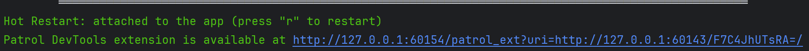
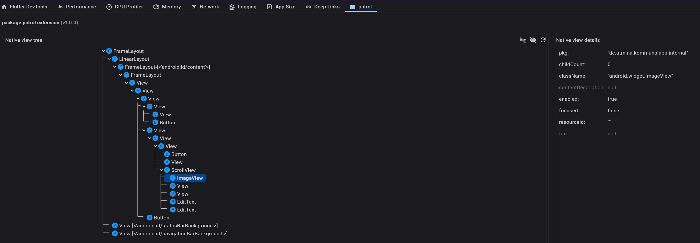

# Integration-Testing in Flutter using Patrol

This project uses [Patrol](https://patrol.leancode.co/) for integration testing with native automation in Flutter. This enables the nearest-to-production testing possible by supporting granting permissions (e.g. for location, camera, gallery, etc.), taking pictures using the camera and selecting pictures from the gallery.

## Quickstart

1. Make sure that your global Dart SDK is 3.3.0 or greater to ensure it's compatible with Patrol > 2.7.0
   ```bash
   flutter --version
   # If it's not, upgrade your global flutter SDK which bundles Dart:
   flutter upgrade
   ```
2. Install `patrol_cli` using dart to get access to the `patrol` command:
   ```bash
   fvm dart pub global activate patrol_cli
   ```
3. Ensure you have a running project (cms, backend, and frontend).
4. Ensure your device or emulator has access to the working project (e.g., by port-forwarding).
   For a physical android device, this can, for example, be done using port-forwarding:
   ```bash
   adb reverse tcp:5000 tcp:5000
   ```
   You may also expose your running frontend using a service like ngrok and in a later step use `--dart-define` to configure the test to target that as backend.
5. Get the device id for your target device (it should be in the second column of the output):
   ```bash
   fvm flutter devices
   ```
6. Run the tests from the `app` directory:
   ```bash
   patrol test -d <device_id> \
     # you can set all required env variables here
     --dart-define=BACKEND_URL=https://example.com/
     # When using a flutter version manager like fvm, provide --flutter-command or PATROL_FLUTTER_COMMAND
     --flutter-command="fvm flutter"
   ```

## Setup of Patrol

To set up Patrol in a project, follow their ["Getting Started"-Guide](https://patrol.leancode.co/getting-started) for both iOS and Android.  
Once done, take a couple additional steps:

1. Add `integration_test/test_bundle.dart` to your project's `.gitignore` file. This file is generated by patrol when running either `patrol develop` or `patrol test`, differs between host-platforms and the target selected in either of the commands.
2. Create `devtools_options.yaml` if it doesn't exist yet and add / edit it like this to enable the Patrol Devtools:
   ```yaml
   extensions:
     - patrol: true
   ```
   This exposes Patrol's extension in Flutter-Devtools, allowing you to more easily figure out selectors required for native automation.

## Adding a new test

To add a new test, create a new `*_test.dart` file in the `integration_test` directory. In it, start with this boilerplate:

```dart
import 'package:patrol/patrol.dart';
import 'package:flutter_test/flutter_test.dart';

void main() {
  patrolTest('Testdescription', ($) async {
    // Your test goes here
  });
}
```

`$` is Patrol's Tester with several useful tools:

- Calling `$` as a function acts as a Finder. More details on possible arguments can be found [here](https://pub.dev/documentation/patrol_finders/latest/patrol_finders/createFinder.html)
- `$` as an object exposes several functions similar to Flutter's integrated tester to tap, drag, and otherwise interact with Flutter widgets including pumping
- `$.native` exposes functionality for native automation like accepting permissions, tapping native elements, turning on / off Wi-Fi, location-services and other device functionality
- `$.native2` exposes the legacy Patrol v2 native automation. While it should be avoided, it has advantages in some cases. For instance, its selector properly combines all properties when finding elements compared to the new API which seems to pick the first one that matches any of the criteria.

You can use `flutter_test`'s `expect`-method to assert the status of widgets on the screen, for example:

```dart
import 'package:patrol/patrol.dart';
import 'package:flutter_test/flutter_test.dart';

void main() {
  patrolTest('Example finds a widget', ($) async {
    expect('Example', findsOneWidget);
  });
}
```

Locally develop your test using `patrol develop -d <device_id> --target integration_test/your_new_test.dart` (including all `--dart-define`s and `--flutter-command` as required).

## Dos and Don'ts

- **DO** always guard calls to `$.native.grantPermission*` methods using `if (await $.native.isPermissionDialogVisible())`.
- **DO** launch your app as closely as possible to the actual app. This includes all kinds of setup-work that occurs in the `main()` method and all widgets that might be wrapped in the `runApp` call.
- **PREFER** assigning `Key`s to relevant widgets to act as a rough equivalent to `data-testid` attributes in web-testing. This avoids text-changes breaking your tests. The widgets associated with the keys can then be referenced in one of two ways:
  ```dart
  // Widget with key:
  const Text('Example', key: Key('example'))
  // Reference with Patrol using explicit key selector:
  $(Key('example'))
  // Reference with Patrol using symbols as syntax sugar:
  $(#example)
  ```
- **PREFER** keeping your `Key`s in a separate file to maintain an overview.
- **PREFER** keeping test-code identical to both platforms. There are cases where that won't work (for example, iOS Simulators don't support cameras).
- **AVOID** `if` in test-code. Exceptions include checking for presence of permission dialogues and platform-specific selectors or actions. Otherwise, tests should be a simple sequence of simulated user-interactions without branching on conditions.
- **DON'T** use delays like `await Future.delayed(const Duration(seconds: 2));` in your testcode before interactions. If your test has to know it has to wait a certain amount of time to be able to click on something, so does your user, and you can't tell him to do that. Instead, create an indication that something is loading and use `$.pumpAndTrySettle()` to wait for the animation to finish. If you want to ensure that a network request has completed loading in the background, before making a test-assertion, schedule a frame after a long enough delay: `$.pump(const Duration(seconds 1))`.

## Good to know

This section contains a series of easy pitfalls, caveats of Patrol and other notes of caution as well as useful tips for development.

### Pitfalls and Caveats

- On Android, using the resourceId of native elements may be finicky. Native elements on your development device don't always have the same resourceId as the elements in the emulator. This project uses an extension method `$.native.tapOneOf` which accepts multiple native selectors and tries them all out.
- In automated testing, it's not uncommon (especially for Android) that the device tested on in the pipeline is smaller than a physical device used during development. For widgets near the bottom, ensure to include `.scrollTo()` before using methods like `.tap()` or `enterText()` on them.
- iOS Simulators don't allow access to the camera! When testing iOS devices, skip parts that require camera access or take the opportunity to test picking an image from the gallery (which has six images by default on the simulator).
- On iOS, it's required to specify the AppID / Bundle ID when using native automation for all apps outside the tested one. A list of Apple's own Bundle IDs can be found [here](https://support.apple.com/en-gb/guide/deployment/depece748c41/web). Note that even while it may look like another app is displayed in front of your app, it might actually be integrated in yours (for instance, the gallery picker).
- On iOS, the default timeout for detecting permission dialogs (1s) has proven to be very unreliable. A timeout of 2 seconds is recommended.
- On iOS, Patrol uses text to find buttons that indicate a permission dialog. This can cause two issues:
  - If the device-language is *not* English, Patrol fails to resolve the buttons, leading to incorrect test-results
  - Some permissions use different wording (for example, access to the gallery), which cannot be granted using the built-in methods. This can be worked around using a manual tap on the native button:
    ```dart
    void main() {
      $.native.tap(
        Selector(text: 'Allow Full Access'),
        appId: 'com.apple.springboard'
      );
    }
    ```
- Patrol does not appear to wait for Flutter animations to complete after native interactions (like picking a picture). This might cause later taps and assertions to fail because there are elements in the way. In case this happens, call `$.pumpAndTrySettle()` after the native interaction.
- Patrol's output is in a terrible format and not easy to read, see [interpreting Patrol's output](#debugging-and-interpreting-logs).
- Patrol currently does not allow screen-recording the test (like, for example, Playwright has), however, there are commands for both iOS Simulators and adb to do screen recordings:
  - `adb shell screenrecord /sdcard/example.mp4` (then pull the recording using `adb pull /sdcard/example.mp4`)
  - `xcrun simctl io booted recordVideo --codec=h264 appVideo.mp4`

### Devtools

- When running `patrol develop`, Patrol will print a debugging URL in the terminal. This opens up the devtools for native selection.

Link to the Devtools in the console:



Devtools after fetching the native hierarchy:



The top-right of the Native view tree contains three buttons (from left to right):

- Switch to raw details (use this mode when using `$.native2`'s `NativeSelector`). **Reload the native view tree after toggling this**
- Show / Hide full node names (you most likely want this turned off; it adds package names to Android UI components in the tree)
- Reload the native view tree

The Native view details pane contains the properties you may use to target the respective element in the native UI.

## Debugging and interpreting logs

Patrol allows debugging using VSCode, see [here](https://patrol.leancode.co/debugging-patrol-tests) for instructions.

### Logs

Patrol's output, especially for `patrol test` is terrible. In general, for developing and debugging tests, use `patrol develop` instead as it also prints logs sent by the app.

#### iOS

You have to use `patrol test --verbose` to get even remotely any idea where things might have failed. This should also be set in the CI.

#### Android

The test creates an HTML report that should be included as CI artefact (use this project as a reference). The report contains the last exception that failed the test.
