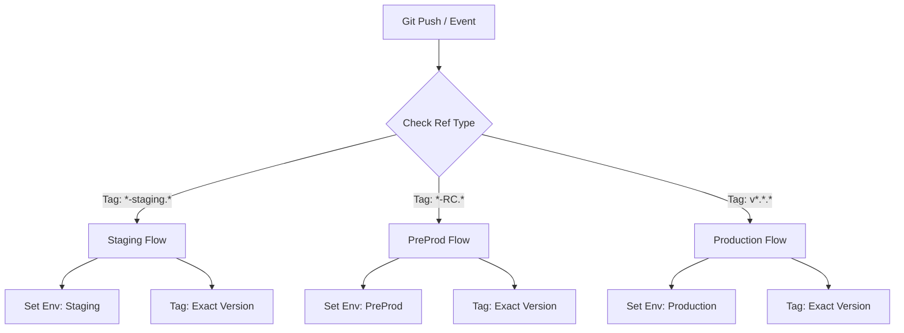

# 🚀 CI/CD Engineering Handbook

This document outlines the Continuous Integration and Continuous Deployment (CI/CD) architecture for the project. It details the file structure, component modularity, and the logic governing environment deployments via `.gitlab-ci.yml`.

---

## ⚡ Pipeline Logic & Workflow

The pipeline behavior is determined dynamically by the `workflow:rules` in the main `.gitlab-ci.yml`. We use Git branches and Tags to automatically configure the target environment, Docker strategies, and logging.

### 📊 Environment Configuration Matrix

The table below describes how variables are set based on the Git reference (Branch or Tag).

| Git Reference | Condition | Target Env | Image Tag Strategy | Sentry Env | Remote Server | Web Client (Bereich A) URL |
| --- | --- | --- | --- | --- | --- | --- |
| **Staging Tag** | `vX.Y.Z-staging.N` | `staging` | `$CI_COMMIT_TAG` | `staging` | `https://app.example.invalid` | [app.example.invalid](https://app.example.invalid) |
| **PreProd Tag** | `vX.Y.Z-RC.N` | `preprod` | `$CI_COMMIT_TAG` | `preprod` | `app.example.invalid` | [app.example.invalid](https://app.example.invalid) |
| **Live Tag** | `vX.Y.Z` | `production` | `$CI_COMMIT_TAG` | `production` | `app.example.invalid` | [app.example.invalid](https://app.example.invalid) |

### 🧠 Logic Visualization
From left to right.

---

## 🚀 Deployment & Versioning Guide

This project uses a **Monorepo** structure. While all code lives in one repository, we treat the release cycles of our components (`backend`, `web`, `app`) independently.

### 1. The Strategy: Scoped Semantic Versioning

We use **Scoped Tags** to trigger deployments for specific components.
A tag consists of three parts: `<component>/<version>[-<suffix>]`

#### 🏷️ Tag Structure

| Environment | Tag Pattern | Example | Action |
| --- | --- | --- | --- |
| **Staging** | `*/v*.*.*-staging.*` | `backend/v1.2.0-staging.1` | Builds specific version and deploys to **Staging**. |
| **PreProd** | `*/v*.*.*-RC.*` | `backend/v1.2.0-RC.1` | Builds specific version and deploys to **PreProd**. |
| **Production** | `*/v*.*.*` | `backend/v1.2.0` | Builds specific version and deploys to **Production**. |

---

### 2. How to Trigger a Deployment

### 🟡 Scenario A: Deploy to Staging (QA / Testing)

To test a specific version on Staging, you must create a git tag.

**Syntax:** `git tag <component>/v<Major>.<Minor>.<Patch>-staging.<Attempt>`

**Example: specific backend version:**

```bash
# 1. Create the tag
git tag backend/v1.0.0-staging.1

# 2. Push the tag to GitLab to trigger the pipeline
git push origin backend/v1.0.0-staging.1

```

**If you find a bug and need to update Staging:**
Increment the **staging number** (the suffix).

```bash
git tag backend/v1.0.0-staging.2
git push origin backend/v1.0.0-staging.2

```

### 🔴 Scenario B: Deploy to Production (Live)

Once a version is verified on Staging, you promote it to Production by removing the `-staging` suffix.

**Syntax:** `git tag <component>/v<Major>.<Minor>.<Patch>`

**Example: Go Live with Backend:**

```bash
# 1. Tag the SAME commit that passed staging
git tag backend/v1.0.0

# 2. Push to trigger production pipeline
git push origin backend/v1.0.0

```

---

### 3. Versioning Rules (SemVer)

When creating tags, follow [Semantic Versioning](https://semver.org/) rules relative to the **last release of that specific component**.

* **Patch (`v1.0.1`)**: Bug fixes only. Backward compatible.
* **Minor (`v1.1.0`)**: New features. Backward compatible.
* **Major (`v2.0.0`)**: Breaking changes (requires client/frontend updates).

---

### 4. Cheat Sheet: Git Commands

```bash
# Check existing tags for backend to see current version
git tag --list 'backend/*'

# Create a Staging Tag (New Feature)
git tag backend/v1.1.0-staging.1
git push origin backend/v1.1.0-staging.1

# Create a Staging Tag (Bugfix for existing release)
git tag backend/v1.0.1-staging.1
git push origin backend/v1.0.1-staging.1

# Promote to Production (Stable)
git tag backend/v1.1.0
git push origin backend/v1.1.0

```

---

## 🛠️ Developer Workflow

### 🏗️ Environment Initialization
To set up your local development environment, run:
```bash
task dev:setup
```
This ensures all base dependencies are correctly installed across the monorepo.

### ✍️ Commit Workflow
We use a standardized commit process to maintain code quality.

*   **Recommended:** Use `task c` to start an interactive commit guide. This automatically formats staged files and ensures your commit message follows the conventional commit standard.
*   **Alternative:** Standard `git commit` will still trigger Husky hooks for formatting and linting.

---

## 🌍 Remote Server Deployment Workflow

The deployment architecture utilizes a remote server provided by the client, orchestrated via SSH and unified Docker Compose configurations.

### Authentication
The pipeline authenticates to the remote host as `deploy_user` using an injected `$SSH_PRIVATE_KEY`. A Deploy Token (`$GITLAB_DEPLOY_TOKEN_USER` / `$GITLAB_DEPLOY_TOKEN_PW`) is used on the remote server to authenticate with the GitLab Registry.

On the application server, `deploy_user` must be a member of the Unix group **`lk-hameln-pyrmont`**. That group typically owns `${MOUNT_POINT}` (e.g. `/srv/lk-app-staging`). Without it, `deployment:start` cannot write `${MOUNT_POINT}/reverse-proxy.config` during the `scp` step (permission denied). Home-directory deploy paths under `/home/deploy_user/deployment/` are unaffected.

### Pipeline Steps
1. **Prepare Environment:** The pipeline prepares necessary environment variables (`.env`, `.dotnet_env`) and renders nginx config from `docker/nginx/reverse-proxy.conf.template`. Optional parts are separate fragments that are appended per environment: the Keycloak server blocks (`reverse-proxy.keycloak.conf.template`) are included unless `KEYCLOAK_PROXY_ENABLED=false` is set in `DEPLOYMENT_ENV_FILE` (e.g. preprod, which uses the staging Keycloak).
2. **Secure Transfer:** Copies `docker/docker-compose.yml`, environment files, and `reverse-proxy.config` to the remote server (`/home/deploy_user/deployment/` and `${MOUNT_POINT}/reverse-proxy.config`) via `scp`.
3. **Remote Execution:** Executes an SSH script on the remote server that:
    *   Logs into the registry.
    *   Stops existing containers (`docker-compose down`).
    *   Pulls the latest images (`docker-compose pull`).
    *   Starts the new containers (`docker-compose up -d --force-recreate`).
4. **Cleanup:** Cleans up sensitive environment files from the remote server immediately after deployment.

---

## 📂 File Structure & Architecture

The CI configuration is modular, split into reusable components located in the `ci/` directory.

```text
ci/
├── backup.gitlab-ci.yml         # Scheduled database backup jobs (artifacts)
├── migration.gitlab-ci.yml      # Manual db:migration: copy dump from one env to another
├── colors.yml                   # formatting and colors defined
├── components/                  # Domain-specific logic
│   ├── app.gitlab-ci.yml
│   ├── backend.gitlab-ci.yml
│   ├── stele.gitlab-ci.yml
│   ├── ui_playground.gitlab-ci.yml
│   └── web.gitlab-ci.yml
├── csharp.gitlab-ci.yml         # Language/Tool specific
├── deployment.gitlab-ci.yml     # Environment workflows (SSH & Docker)
├── docs.gitlab-ci.yml           # Documentation
├── e2e.gitlab-ci.yml            # E2E Testing (Disabled)
├── fastlane.gitlab-ci.yml       # Mobile automation
├── flutter.gitlab-ci.yml        # Flutter setup
├── helm.gitlab-ci.yml           # Helm setup
├── pnpm.gitlab-ci.yml           # Node/PNPM setup
├── production.gitlab-ci.yml     # Production workflow
├── qa.gitlab-ci.yml             # QA Environment (Disabled)
├── release.gitlab-ci.yml        # Release logic
├── staging.gitlab-ci.yml        # Staging workflow
└── template.gitlab-ci.yml       # Base templates (incl. SSH connection configs)

```

### 1. Component Pipelines (`ci/components/`)

These files define the specific build and test jobs for the architectural layers of the application.

* 📱 **`app.gitlab-ci.yml`**: Mobile application pipeline (Android/iOS).
* 🔙 **`backend.gitlab-ci.yml`**: Backend service pipelines.
* 📺 **`stele.gitlab-ci.yml`**: Infostele (React/Vite) build, Docker image package, and registry push.
* 🎨 **`ui_playground.gitlab-ci.yml`**: UI Playground pipeline for building and deploying Bereich-A Storybook and Stele Storybook (`deploy:ui-playgrounds` on `main`).
* 🌐 **`web.gitlab-ci.yml`**: Web application pipelines (Bereich A & B).

### 2. Language & Tool Templates

Reusable templates that abstract the complexity of specific tools.

* **Flutter (`flutter.gitlab-ci.yml`)**: FVM setup, version management, and Flutter commands.
* **C# / .NET (`csharp.gitlab-ci.yml`)**: Build and test templates for .NET services.
* **Node / PNPM (`pnpm.gitlab-ci.yml`)**: Node.js environment setup and dependency management.
* **Fastlane (`fastlane.gitlab-ci.yml`)**: Mobile automation base for app store interaction.
* **Helm (`helm.gitlab-ci.yml`)**: Preparation of Helm charts and environment variable injection for Kubernetes.

### 3. Deployment & Release Strategy

Files that orchestrate the release process across different environments.

* **Deployment Core (`deployment.gitlab-ci.yml`)**: Handles SSH orchestration, file transfers, container lifecycle (stop/start/pull) on the remote host, and cleanup.
* **SSH Configuration (`template.gitlab-ci.yml`)**: Contains the `.ssh-connection` template to bootstrap agents, keys, and trusted hosts on the CI runner.
* **Release Logic (`release.gitlab-ci.yml`)**: General templates for Web, Android, and iOS releases.
* **Staging & Production (`staging.gitlab-ci.yml` / `production.gitlab-ci.yml`)**: Extends the general release templates with environment-specific rules defined in the [Configuration Matrix](https://www.google.com/search?q=%23-environment-configuration-matrix).

### 4. Utilities

* **`colors.yml`**: ANSI color codes for prettier CLI logs.
* **`docs.gitlab-ci.yml`**: Antora-based documentation generation.
* **`template.gitlab-ci.yml`**: Base jobs (e.g., `push`, `package`) used by other files.
* **`e2e.gitlab-ci.yml` / `qa.gitlab-ci.yml**`: *[Currently Disabled]* Configs for End-to-End testing and QA instances.

---

## 💾 Backup & Data Utilities

The following scripts facilitate data management and disaster recovery:

* **`scripts/database_dump.sh`**: Scans for running `hameln-postgres`, `hameln-postgres-archive`, and `hameln-mongodb` containers, extracts environment credentials dynamically, and creates timestamped local database dumps (`*-postgres.dump`, `*-postgres-archive.dump`, `*-mongo-db.dump`).
* **`scripts/media_files_dump.sh`**: Detects the Payload CMS container (`hameln-bereich-b`) and securely extracts uploaded media assets to a local directory.

### Database migration between environments (`db:migration`)

The job **`db:migration`** in [`migration.gitlab-ci.yml`](migration.gitlab-ci.yml) is **not** part of the default branch pipeline. It runs only when a pipeline is started from the GitLab UI (**Run pipeline** / `CI_PIPELINE_SOURCE=web`).

**Pipeline inputs** (see root [`.gitlab-ci.yml`](../.gitlab-ci.yml) `spec:inputs`):

| Input | Purpose |
| --- | --- |
| `source_environment` | Where to read the backup job from (`staging`, `preprod`, `production`). |
| `destination_environment` | Target environment for the restore (`staging`, `preprod`). |
| `backup_date` | `latest` (default) or a calendar day `YYYY-MM-DD` in **UTC** (the day of the successful `backup:<source>` job’s `created_at`). Must fall within the **last 5 days**, matching backup job **artifact** retention (`expire_in: 5d` in `backup.gitlab-ci.yml`). |

The job finds the right successful `backup:<source>` job via the GitLab Jobs API, downloads its **database_dumps** artifact, copies dumps to the destination server, and runs [`scripts/remote_restore.sh`](../scripts/remote_restore.sh).

---

### 💡 Variable Reference

* **`IMAGE_TAG`**: Controls versioning. `latest` is used for dev to keep storage low, while specific tags (e.g., `v1.0.0`) are used in Staging/Prod for traceability and rollbacks.
* **`STELE_IMAGE_VERSION`**: Resolved by [`.gitlab/scripts/get_docker_images.sh`](../.gitlab/scripts/get_docker_images.sh) for the `stele` service in `docker/docker-compose.yml` (same `backend-*` Git tag “time machine” as backend and web images).

### Infostele (Stele)

Stele is a React SPA in `web/stele/`, not part of the Flutter app. It deploys with the **unified** remote stack (`docker/docker-compose.yml`), not a separate compose file.

| Stage | Job | Notes |
| --- | --- | --- |
| **build** | `build:stele` | Copies `DEPLOYMENT_ENV_FILE` → `stele/.env.production`, then `pnpm turbo build --filter stele...` |
| **package** | `package:stele` | `docker build -f web/stele/docker/Dockerfile web/stele` (expects `dist/` artifact) |
| **push** | `push:stele` | Pushes `$CI_REGISTRY_IMAGE/stele:stele-<version>` |

**When it runs**

- **`backend-*` Git tags** (e.g. `backend-v1.2.0-staging.1`): build, package, and push together with backend/web release pipelines.
- **Feature / MR pipelines** (`TARGET_ENV=feature`): build only when `web/stele/**` changes; push is disabled.

**Deployment:** `deployment:start` in `deployment.gitlab-ci.yml` optionally needs `push:stele`, runs `get_docker_images.sh` (sets `STELE_IMAGE_VERSION`), renders `docker/nginx/reverse-proxy.conf.template` from `DEPLOYMENT_ENV_FILE` (see `.env.nginx.example`), copies it to `${MOUNT_POINT}/reverse-proxy.config`, and starts the stack. Nginx on the main proxy serves the hostnames from `APP_DOMAIN` / `STELE_DOMAIN` and forwards Stele traffic to the Stele container, which proxies `/graphql` and `/api` to `STELE_BACKEND_ORIGIN` (typically `http://backend:8080` on the Docker network).

* **`DOCKER_COMPOSE_FILE_PATH`**: Switches between `development` and `production` Docker compose configurations.
* **`DEPLOY_RUNNER_TAG`**: Ensures development workloads run on specific runners (`deploy-ha-py`), likely to reserve separate resources for production.
* **`SERVER_IP`**: The target IP address of the client's remote deployment server.
* **`SSH_PRIVATE_KEY`**: Pipeline variable used to authenticate the GitLab CI runner with the remote `deploy_user`.
* **`GITLAB_DEPLOY_TOKEN_USER` & `GITLAB_DEPLOY_TOKEN_PW`**: Auth credentials scoped specifically for pulling images from the project registry directly to the remote server.

---


### 🔥 CI/CD Configuration & Firebase Integration

To maintain security and environment separation, this project does not store Firebase configuration files (`google-services.json` and `GoogleService-Info.plist`) in version control. Instead, these files are injected dynamically during the CI/CD pipeline execution using **GitLab Secure Files**.

### Firebase Configuration Injection

The pipeline utilize the GitLab Mobile DevOps [installer](https://gitlab.com/gitlab-org/incubation-engineering/mobile-devops/download-secure-files) to download protected configuration files into the runner's workspace.

#### How it Works:

1. **Download:** The pipeline executes a `curl` command to download the Secure Files installer.
2. **Extraction:** Secure files are downloaded into a local `.secure_files/` directory.
3. **Assignment:** Based on the environment variables defined in the GitLab CI settings, the correct file is renamed and moved to the required platform directory.

| Platform | Variable Name | Destination Path |
| --- | --- | --- |
| **Android** | `$FIREBASE_ANDROID_CONFIG` | `app/android/app/google-services.json` |
| **iOS** | `$FIREBASE_IOS_CONFIG` | `app/ios/Runner/GoogleService-Info.plist` |
| **Bacekdn** | `$FIREBASE_CONFIG` | `backend/API/kommunalapp-service-account.json` |


### Environment Handling (Flavors)

We use Flutter flavors to distinguish between environments. The CI/CD pipeline maps these flavors to the correct bundle identifiers and Firebase projects. You can run the app locally in different environments using the following task commands:

* `task app:dev` - Run app in **Development** environment
* `task app:stag` - Run app in **Staging** environment
* `task app:preprod` - Run app in **PreProd** environment
* `task app:prod` - Run app in **Production** environment

We use Flutter flavors to distinguish between environments. The CI/CD pipeline maps these flavors to the correct bundle identifiers and Firebase projects:

* **Production:** `de.landkreis.hapy.app` (HaPy Firebase account)
* **PreProd:** `de.landkreis.hapy.app.preprod` (HaPy Firebase account)
* **Staging:** `de.landkreis.hapy.app.staging` (HaPy Firebase account)

### Local Development Setup

To run the app locally, you must manually place the valid Firebase configuration files in the respective folders, as they are ignored by `.gitignore`:

* **Android:** `app/android/app/`
* **iOS:** `app/ios/Runner/`

---

### 🔐 Secure Files in GitLab
These files are injected in the build pipeline of the various applications.
| File Name | Environment | Category | Description |
| --- | --- | --- | --- |
| `kommunalapp-service-account-production.json` | **Production** | Backend Auth | **Sensitive:** Used by the backend server to authenticate with the Staging Firebase project to trigger push notifications.  |
| `kommunalapp-service-account-preprod.json` | **PreProd** | Backend Auth | **Sensitive:** Used by the backend server to authenticate with the Staging Firebase project to trigger push notifications.  |
| `kommunalapp-service-account-staging.json` | **Staging** | Backend Auth | **Sensitive:** Used by the backend or CI/CD to authenticate with the Development Firebase project for testing push notifications.  |

---
