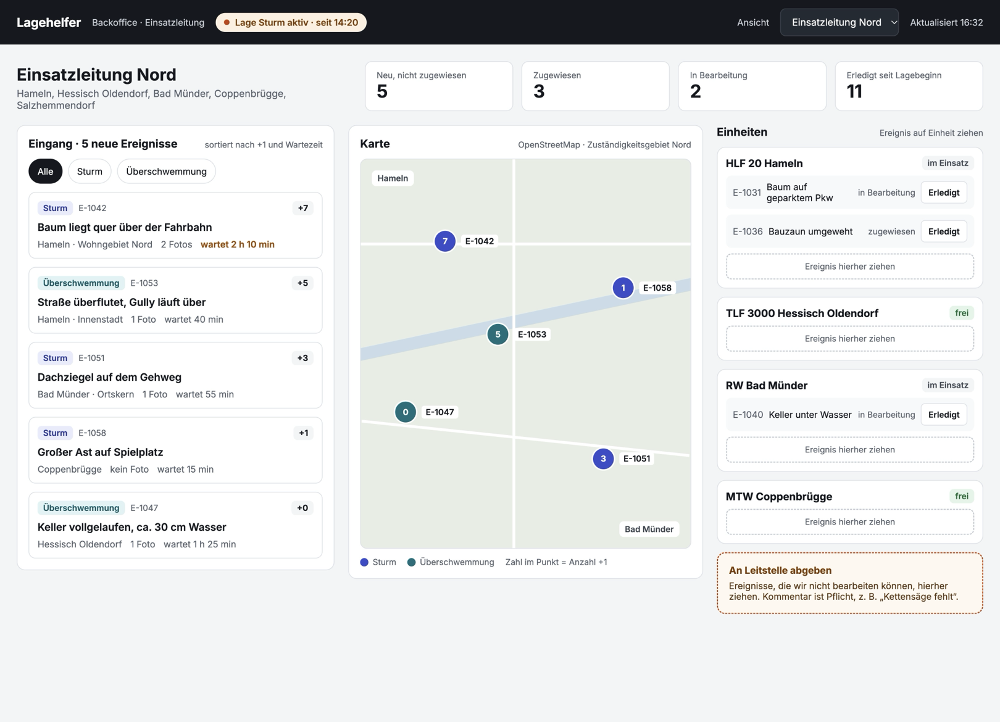
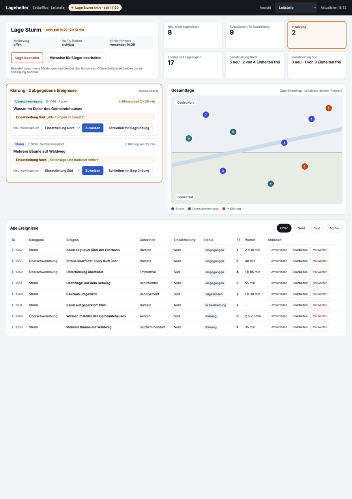

# Übergabe: Frontend-Prototyp Backoffice „Leitstelle & Einsatzleitung“

Stand 21.11.2026. Quelle: Mock „Lagehelfer – Dashboards Leitstelle & Einsatzleitung“ ([PDF](assets/mock-dashboards-und-buergerflow.pdf)). Deine Aufgabe sind **Seite 1 (Einsatzleitung) und Seite 2 (Leitstelle)**. Seiten 3–10 zeigen den Bürger-Flow und sind nur Kontext: Was die Leitstelle schaltet, sieht die Bürgerin dort (Button „Vorfall melden“, Meldung, Status).

**Aktueller Mock:** „DEICH – Dashboards & Meldeflow“ (Link im Team erfragen), Boards „Einsatzleitung Nord“ und „Leitstelle (Super-Admin)“. Er ist neuer als PDF und Screenshots in `assets/` und ergänzt KI-Hinweise, Klassen, Ausrüstung und Notfall-Erkennung. Alles, was nur im aktuellen Mock steht, ist unten mit **(neu)** markiert.

## Kurzfassung

- Gebaut wird im bestehenden Backoffice **`web/bereich-a`** (React 19, Vite, Tailwind 3, react-router 7, urql + GraphQL-Codegen, MapLibre). Dort gibt es unter `/lage` schon eine schlichte Lage-Verwaltung, an die du andocken kannst.
- Zwei Ansichten, umschaltbar über „Ansicht“ oben rechts: **Einsatzleitung** (ein Zuständigkeitsgebiet, Ereignisse auf Einheiten verteilen) und **Leitstelle** (Gesamtlage, Lage steuern, abgegebene Ereignisse klären).
- Die API deckt die Dashboards fast vollständig ab: Meldungen einer Lage mit Nummer, Status und +1-Zähler, Einheiten, Zuweisen, Klärung, Umverteilen, Verwerfen, Lage beenden und Bürger-Hinweis (Tabelle in Abschnitt 5). Nur der NINA-Status ist nicht im Backend.
- Ziel ist ein klickbarer Prototyp für die Demo, kein Produktivcode: Drag & Drop, Statuswechsel und Klärung müssen sich echt anfühlen.
- **(neu)** Der aktuelle Mock bringt Elemente, die das Backend noch nicht liefert: Klasse A–D und KI-Vorschlag je Ereignis, Ausrüstung der Einheiten mit Zuweisungs-Prüfung, KI-Lagebild, Notfall-Erkennung. Vorschlag zur Umsetzung in Abschnitt 5a; bis dahin im Frontend mit Mock-Werten anzeigen.

---

## 1. Rollen und Ansichten

| Ansicht | Wer | Sieht | Demo-Login (lokal) |
|---|---|---|---|
| Einsatzleitung | Mitarbeitergruppe, die für ein oder mehrere Gebiete zuständig ist | nur Ereignisse und Einheiten des eigenen Zuständigkeitsgebiets | `einsatzleitung-hameln@example.com` |
| Leitstelle | Admin / Superadmin der KRL | alle Gebiete, alle Einsatzleitungen, Lage-Steuerung | `admin-krl@example.com`, `superadmin-krl@example.com` |

Passwort: `demo.passwort` in `Dokumente/seed.json` (nicht ins Repo schreiben, das Repo ist öffentlich). Alle vier Demo-User haben das globale Recht `LageHelfer`.

Der Umschalter „Ansicht“ im Mock ist ein Demo-Hilfsmittel. Im Prototyp reicht: Vorauswahl aus der Rolle des eingeloggten Users, manuell umschaltbar. **Rollen werden im Backend nicht pro Gebiet geprüft**, jeder mit `LageHelfer` darf alles. Trennung also clientseitig über `my { ... on Mitarbeiter { gruppen { id name } } }` gegen `gebiet.einsatzleitungen`.

---

## 2. Ansicht Einsatzleitung (Mock Seite 1)



**Kopfzeile (beide Ansichten gleich):** Logo „Lagehelfer“ (im aktuellen Mock „DEICH“, Name noch offen), Breadcrumb „Backoffice · Einsatzleitung“, Lage-Pill „● Lage Sturm aktiv · seit 14:20“ (nur sichtbar, wenn eine Lage aktiv ist), Ansicht-Dropdown (*Einsatzleitung Nord*, *Einsatzleitung Süd*, *Leitstelle*), „Aktualisiert 16:32“ (Zeitpunkt des letzten Datenabrufs).

**Titelzeile:** Name der Einsatzleitung + Liste der Gemeinden im Zuständigkeitsgebiet. Rechts vier Kennzahlen: *Neu, nicht zugewiesen* · *Zugewiesen* · *In Bearbeitung* · *Erledigt seit Lagebeginn*.

**Spalte 1 – Eingang**
- Nur Ereignisse im Status *eingegangen* (noch keiner Einheit zugewiesen).
- Sortierung: **(neu)** zuerst nach Klasse (A vor B vor C vor D), dann nach +1-Anzahl absteigend, dann nach Wartezeit absteigend.
- Filter-Chips: *Alle* + je Kategorie (im Mock *Sturm*, *Überschwemmung*).
- Karte je Ereignis: Kategorie-Badge (Farbe je Kategorie), ID (`E-1042`), +1-Zähler rechts, Titel, `Gemeinde · Ortsteil`, Fotoanzahl, Wartezeit. Wartezeit über einem Schwellwert farbig hervorheben (im Mock orange bei 2 h 10 min; Schwelle festlegen, Vorschlag 2 h).
- **(neu)** Klassen-Badge neben der Kategorie, nach dem Eisenhower-Schema: *A · dringend + wichtig* (rot), *B · wichtig*, *C · dringend*, *D*.
- **(neu)** Zeile „KI-Vorschlag“ unter dem Titel: Dringlichkeit und benötigte Ausrüstung, z. B. „Dringlichkeit hoch · braucht Kettensäge“.
- Karten sind **ziehbar** (Drag-Quelle).

**Spalte 2 – Karte**
- OSM-Hintergrund, Ausschnitt auf das Zuständigkeitsgebiet (Polygone der Gebiete).
- Ein Marker je offenem Ereignis, Farbe = Kategorie, Zahl im Marker = +1-Anzahl, daneben die ID.
- Wünschenswert: Hover/Klick auf Marker hebt die Karte im Eingang hervor und umgekehrt.

**Spalte 3 – Einheiten**
- Kachel je Einheit: Name (z. B. „HLF 20 Hameln“), Status-Badge *frei* / *im Einsatz* (abgeleitet: im Einsatz, sobald mindestens ein Ereignis zugeordnet ist).
- **(neu)** Unter dem Namen die Ausrüstung („Kettensäge, Pumpe, Absperrung“) und der Fahrzeugstatus „aus ELS“: *Status 2 · frei auf Wache* / *Status 4 · am Einsatzort*. Eine ELS-Anbindung gibt es nicht; den Status wie im Mock aus frei/im Einsatz ableiten.
- Darin die zugeordneten Ereignisse mit ID, Kurztitel, Status (*zugewiesen* / *in Bearbeitung*) und Button **Erledigt**.
- Drop-Zone „Ereignis hierher ziehen“. Drop ⇒ Ereignis wird *zugewiesen*, verschwindet aus dem Eingang.
- **(neu)** Zuweisungs-Prüfung: Fehlt der Einheit Ausrüstung, die der KI-Vorschlag verlangt, erscheint oben in der Spalte ein Hinweis (`role="alert"`) statt der Zuweisung: „Zuweisung nicht möglich. E-1042 braucht eine Motorkettensäge. TLF 3000 Hessisch Oldendorf hat keine an Bord.“ Darunter passende freie Einheiten und die passenden, die im Einsatz sind. Ob das hart blockiert oder nur warnt, ist offen (Abschnitt 9).
- Unten Drop-Zone **„An Leitstelle abgeben“**: Drop öffnet einen Dialog mit **Pflicht-Kommentar** (Beispiel „Kettensäge fehlt“). Danach Status *in Klärung*, Ereignis taucht in der Leitstelle unter „Klärung“ auf.

Offen im Mock: Wie wird aus *zugewiesen* ein *in Bearbeitung*? Die API bietet dafür `meldungFortsetzen(HILFE_EINLEITEN)`; Vorschlag: Klick auf das Ereignis in der Einheit oder ein zweiter Button „Hilfe eingeleitet“. Bitte mit uns abstimmen.

---

## 3. Ansicht Leitstelle (Mock Seite 2)



**Lage-Kachel (oben links)**
- Titel „Lage Sturm“, Badge „aktiv seit 14:20 · 2 h 12 min“.
- Statusfelder: *Meldeweg* (offen/geschlossen), *Ha-Py Button* (sichtbar/ausgeblendet), *NINA-Hinweis* (versendet + Uhrzeit), **(neu)** *B-Team* („4 Plätze besetzt“, Lagetelefon; gemockt).
- **Lage beenden** (rot, mit Bestätigungsdialog). Text darunter beschreibt die Wirkung: keine neuen Meldungen, Button in der Bürger-App weg, offene Ereignisse bleiben bis zur Erledigung sichtbar.
- **Hinweise für Bürger bearbeiten**: Dialog für den Text, den die Bürger-App im Lage-Banner zeigt (Mock Seite 3).
- **(neu)** **NINA-Textvorlage anzeigen**: Dialog mit einem kopierbaren Warntext für NINA, gebaut aus Lage-Titel und Bürger-Hinweis. Reines Frontend.

**(neu) KI-Lagebild (unter der Lage-Kachel, links, lila Rahmen)**
- Badge „KI-Lagebild“, Überschrift „Stand 16:30 · automatisch alle 15 Minuten“.
- Zwei, drei Sätze Fließtext: Schwerpunkte, Trends („+3 in 30 Minuten“), Engpässe („Pumpen im Gebiet Süd voll ausgelastet“).
- Fußzeile: „Zusammenfassung durch KI, ohne Gewähr. Grundlage: 26 Meldungen dieser Lage.“

**(neu) Möglicher Notfall (daneben, rot)**
- Titel „1 möglicher Notfall erkannt“; je Treffer ID, Gemeinde, Zitat aus der Beschreibung („Baum aufs Haus gefallen, Nachbarin noch drin“) und „Bürger wurde zur 112 geleitet“.
- Aktionen: **An ELS übergeben (EIDO)** (primär, rot) und **Geprüft, kein Notfall**. Beides nimmt den Treffer aus der Liste. Die EIDO-Übergabe ist für die Demo nur angedeutet (z. B. Toast „an ELS übergeben“).
- Gemeint sind Meldungen, bei denen die Vorfragen im Wizard verneint wurden, der Freitext aber nach Gefahr für Leib und Leben klingt. Die Kachel nur zeigen, wenn es Treffer gibt.
- Wünschenswert für die Demo: Ohne aktive Lage zeigt die Kachel „Lage ausrufen“ (Titel, Gebiete wählen). Das gibt es im Mock nicht, macht die Demo aber rund.

**Kennzahlen (oben rechts):** *Neu, nicht zugewiesen* · *Zugewiesen / in Bearbeitung* · *In Klärung* (hervorgehoben, sobald > 0) · *Erledigt seit Lagebeginn* · je Einsatzleitung eine Kachel „5 neu · 2 von 4 Einheiten frei“.

**Klärung (Mitte links)**
- Alle abgegebenen Ereignisse, älteste zuerst.
- Karte: Kategorie, ID, Gemeinde, „in Klärung seit …“, Titel, Kommentar der abgebenden Einsatzleitung.
- Aktionen: Dropdown „Neu zuweisen an“ (andere Einsatzleitung, vorbelegt mit einer, die nicht abgegeben hat) + **Zuweisen**; **Schließen mit Begründung** (Dialog, Pflichttext).

**Gesamtlage (Mitte rechts):** Karte des ganzen Landkreises, Gebiete der Einsatzleitungen als eingefärbte Flächen mit Label, Marker wie bei der Einsatzleitung, Ereignisse in Klärung als rotes „!“.

**Alle Ereignisse (unten)**
- Tabelle: ID · Kategorie · Ereignis · Gemeinde · Einsatzleitung · Status-Badge · +1 · Wartet · Aktionen.
- Filter-Tabs: *Offen* · je Einsatzleitung (*Nord*, *Süd*) · *Archiv* (erledigt/verworfen).
- Aktionen je Zeile: **Umverteilen** (an andere Einsatzleitung), **Bearbeiten** (Kategorie, Titel, Ort korrigieren), **Verwerfen** (rot, Bestätigung mit Begründung).

---

## 4. Statusmodell eines Ereignisses

Das Backend liefert den Stand direkt als `Ausfuehrung.ereignisStatus` (`EreignisStatus`). Die Aktionen sind eigene Mutations:

```
EINGEGANGEN ──meldungEinheitZuweisen──▶ ZUGEWIESEN ──meldungFortsetzen(HILFE_EINLEITEN)──▶ IN_BEARBEITUNG
     ▲   │                                   │                                                │
     │   │                                   └──────meldungFortsetzen(EINSATZ_ABSCHLIESSEN)───┴──▶ ERLEDIGT
     │   └──meldungAnLeitstelleAbgeben(kommentar)──▶ IN_KLAERUNG
     │                                                  │
     └────────────meldungUmverteilen(gruppe)────────────┤   (Leitstelle, auch direkt aus der Tabelle)
                                                        └──meldungVerwerfen(begruendung)──▶ VERWORFEN
```

- `meldungEinheitZuweisen(einheitId: null)` legt die Meldung zurück in den Eingang.
- `meldungFortsetzen(EINSATZ_ABSCHLIESSEN)` geht bei Bedarf vorher automatisch „Hilfe einleiten“. Der Button „Erledigt“ funktioniert also auch bei *zugewiesen*.
- „Verwerfen“ (Tabelle) und „Schließen mit Begründung“ (Klärung) sind dieselbe Mutation `meldungVerwerfen`.
- Bürgerseite (`ausfuehrungStatusAnonym`, `MeldungStatus`): ZUGEWIESEN → `IN_BEARBEITUNG`, IN_BEARBEITUNG → `HILFE_UNTERWEGS`, ERLEDIGT und VERWORFEN → `ABGESCHLOSSEN`. Die Begründung sehen Bürger:innen nicht.

---

## 5. Datenlage: was die API liefert

Endpunkte, Token und Rezepte: Skill `.agents/skills/graphql-api` (vor allem `references/lagehelfer.md`). Schema: `web/bereich-a/schema.graphql`.

| UI-Element | Quelle | Hinweis |
|---|---|---|
| Lage-Pill, Titel, „aktiv seit“ | ✅ `lagen(status: ACTIVE)` → `title`, `gebiete[].liveAt` | „seit“ = frühestes `liveAt` |
| Meldeweg offen / Ha-Py Button sichtbar | ✅ abgeleitet | offen, solange mindestens ein `LageGebiet` `LIVE` ist |
| Gebiete, Polygone, Einsatzleitung je Gebiet | ✅ `gebiete { geometry einsatzleitungen { id name } }` | `geometry` ist ein GeoJSON-String → `JSON.parse` |
| Ereignisse einer Lage | ✅ `lageMeldungen(lageId, offen)` | Leitstelle (Admin/Superadmin) sieht alle, Einsatzleitung nur die ihrer Gruppen. `offen: false` = Archiv |
| Kurz-ID `E-1042` | ✅ `meldungsnummer` | Zahl ab 1000, Präfix „E-“ setzt das Frontend. Auch in `ausfuehrungCreateAnonym` und `ausfuehrungStatusAnonym` |
| Status-Badge | ✅ `ereignisStatus` | siehe Abschnitt 4 |
| Kategorie, Beschreibung, Fotos, Standort | ✅ `slotValues` (Slots `kategorie`, `beschreibung`, `bilder`, `adresse`) | unverschlüsselt (`PlainSlotValue`). Verschlüsselt sind nur `rueckrufnummer`, `prioritaet`, `interneNotiz`; Entschlüsseln wie in `components/ui/decrypt-value.tsx` |
| Gemeinde | ✅ `Ausfuehrung.lage.gebietName` | Ortsteil („Wohngebiet Nord“) gibt es nicht, ggf. aus Adresse |
| Einsatzleitung eines Ereignisses | ✅ `istZustaendigkeit.mitarbeiterGruppe` | |
| Wartezeit | ✅ `createdAt` | |
| **+1-Zähler** | ✅ `anzahlBestaetigungen`, Details in `bestaetigungen { createdAt fotos }` | Bürger-App: `activeLagen.meldungen { id kategorie anzahlBestaetigungen }` und `meldungBestaetigen(publicId, fotos)` |
| **Einheiten** | ✅ `einheiten(mitarbeiterGruppeId)`, `createEinheit`, `deleteEinheit`, `Ausfuehrung.einheit` | „frei / im Einsatz“ aus den offenen Meldungen je Einheit ableiten. Demo-Einheiten über `einheiten` je Bereich in `seed.json` |
| Ereignis auf Einheit ziehen | ✅ `meldungEinheitZuweisen` | nur Einheiten der zuständigen Einsatzleitung |
| „Erledigt“ / in Bearbeitung | ✅ `meldungFortsetzen(aktion)` | geht die Prozess-Kanten, Bürger:innen sehen den neuen Stand |
| **An Leitstelle abgeben, Klärung** | ✅ `meldungAnLeitstelleAbgeben(kommentar)`, `klaerungSeit`, `klaerungKommentar` | Kommentar ist Pflicht |
| Neu zuweisen / Umverteilen | ✅ `meldungUmverteilen(mitarbeiterGruppeId)` | nur Leitstelle |
| Verwerfen / Schließen mit Begründung | ✅ `meldungVerwerfen(begruendung)`, `verwerfenGrund` | nur Leitstelle |
| **Lage beenden** | ✅ `closeLage(lageId)` | beendet alle laufenden Gebiete, `Lage.status = CLOSED`; offene Meldungen bleiben in `lageMeldungen` |
| **Hinweise für Bürger** | ✅ `updateLageWarningText(lageId, warningText)` | erscheint in `activeLagen.warningText` |
| **NINA-Hinweis** | ❌ | rein anzeigen/mocken |
| Live-Aktualisierung | ⚠️ keine Subscriptions | Polling, z. B. alle 15 s mit `requestPolicy: 'network-only'`, „Aktualisiert“ = letzter Abruf |
| **(neu)** Klasse A–D | ❌ | Es gibt nur den verschlüsselten Slot `prioritaet` (Hoch/Niedrig), siehe 5a |
| **(neu)** KI-Vorschlag (Dringlichkeit, Ausrüstung) | ❌ | siehe 5a |
| **(neu)** Ausrüstung der Einheiten | ❌ | `Einheit` hat nur `name`, siehe 5a |
| **(neu)** Zuweisungs-Prüfung | ❌ | im Client aus KI-Ausrüstung und Einheiten-Ausrüstung ableiten |
| **(neu)** ELS-Fahrzeugstatus | ❌ | aus frei/im Einsatz ableiten (Status 2 / Status 4) |
| **(neu)** KI-Lagebild | ❌ | siehe 5a |
| **(neu)** Möglicher Notfall, EIDO-Übergabe | ❌ | Flag siehe 5a; EIDO nur andeuten |
| **(neu)** B-Team-Plätze, NINA-Textvorlage | ❌ | mocken bzw. im Frontend aus Lage-Daten bauen |

Alle Mutations liefern fachliche Fehler im Feld `errors` (z. B. `MeldungInKlaerungError`, `NotAllowedError`), immer `errors { __typename ... on Error { message } }` abfragen. Rollen: Admin und Superadmin gelten als Leitstelle, Nutzer mit Gruppe als deren Einsatzleitung. Alle brauchen das globale Recht `LageHelfer`.

**Empfehlung:** Echte API verwenden; nur der NINA-Status bleibt gemockt. Falls das Backend in der Demo nicht läuft, eine dünne Datenschicht (`useLageDashboard()` o. ä.) mit Mock-Variante auf Basis der Daten in Abschnitt 7 vorsehen.

### 5a. (neu) Vorschlag: Backend-Erweiterung für den aktuellen Mock

Noch nicht gebaut, Namen sind Vorschläge. Bis es da ist, zeigt das Frontend die Felder mit Werten aus Abschnitt 7; die Datenschicht so schneiden, dass sie später nur die Quelle tauscht.

| Was | Vorschlag |
|---|---|
| Ausrüstung | `Einheit.ausruestung: [String!]!` (freie Begriffe wie „Kettensäge“, „Pumpe“), Migration, `einheiten[].ausruestung` in `seed.json`, Parameter in `createEinheit` |
| KI-Einschätzung je Meldung | Beim Eingang (`ausfuehrungCreateAnonym`) einmal klassifizieren und an der `Ausfuehrung` speichern: `kiDringlichkeit` (`HOCH`/`MITTEL`/`NIEDRIG`), `kiAusruestung: [String!]`, `kiKlasse` (`A`–`D`), `moeglicherNotfall: Boolean` |
| Klasse | `klasse` = `kiKlasse`, bis die Einsatzleitung sie überschreibt (`meldungKlasseSetzen`). Verhältnis zum Slot `prioritaet` ist offen (Abschnitt 9) |
| Notfall prüfen | `meldungNotfallPruefen(ausfuehrungId, ergebnis: AN_ELS_UEBERGEBEN \| KEIN_NOTFALL)`, speichert Ergebnis, Zeit und Bearbeiter; nur Leitstelle |
| KI-Lagebild | Query `lageLagebild(lageId) { text erstelltAt anzahlMeldungen }`, höchstens alle 15 Minuten neu erzeugt, dazwischen gecacht |
| KI-Aufruf | LLM-Aufruf im Backend, Schlüssel nur per Konfiguration. Für Demo und Tests ein regelbasierter Fallback ohne Schlüssel (Stichwörter wie „Baum“ → Kettensäge, „Keller“/„Wasser“ → Pumpe, „eingeklemmt“/„noch drin“ → möglicher Notfall) |

---

## 6. Technischer Rahmen

- **Ort:** `web/bereich-a/src/routes/lage/` erweitern, z. B. `routes/lage/dashboard/` mit Routen `/lage/einsatzleitung` und `/lage/leitstelle`. Route-Definition und Rechteprüfung siehe `routes/lage/index.tsx` (`IfFunktionsberechtigung` mit `GlobaleFunktionsberechtigung.LageHelfer`), Menüeintrag in `components/user-menu/menu-items.tsx`.
- **Wiederverwenden:** `PageShell`/`PageHeader` (`components/page-shell.tsx`), `Button` (`components/ui/button`), `Modal` (`components/modal`), Status-Labels und -Übergänge für Gebiete in `routes/lage/lage-status.tsx`, GraphQL-Fragmente in `routes/lage/lage.graphql`.
- **GraphQL:** Operationen in `*.graphql` neben der Komponente, `pnpm graphql` (läuft in `pnpm dev` im Watch-Modus) erzeugt `*.generated.ts` mit Hooks. Fehler in Mutations kommen mit HTTP 200 im Feld `errors`, immer `errors { __typename ... on Error { message } }` abfragen.
- **Karte:** `maplibre-gl` 6 ist da, Theme in `utils/map-theme.ts`, Beispiel in `routes/antraege/detail/components/felder/location-formular-feld.tsx`. **Fallstrick:** Ohne `maplibregl.setWorkerUrl(maplibreWorkerUrl)` bleibt die Karte unter Vite leer, ohne Fehlermeldung (siehe Beispieldatei, Zeile 11).
- **Drag & Drop:** keine Bibliothek im Projekt. Natives HTML5-DnD reicht für den Prototyp; wer `@dnd-kit` nimmt, stimmt das kurz ab.
- **Layout:** Der Mock ist für ≥ 1280 px gebaut (drei Spalten). Darunter genügt es, die Spalten zu stapeln.
- **Code-Konventionen:** `ha-py-app/CLAUDE.md` (Variablen englisch, Fachbegriffe deutsch; keine erzählenden Kommentare; Conventional Commits mit Scope `bereich-a` und `Changelog:`-Trailer).

**Lokal starten:** Setup und Seed siehe [lagehelfer-seeding-lokal.md](../lagehelfer-seeding-lokal.md). Danach `task start` im Repo-Root, Backoffice auf http://localhost:3000, GraphQL/Nitro auf http://localhost:5000/graphql. Für einen Token im Browser nach dem Login: `JSON.parse(atob(sessionStorage.__ka_session)).token`.

---

## 7. Mock-Daten aus dem PDF (als Fixture übernehmen)

**Lage:** „Sturm“, aktiv seit 14:20, NINA-Hinweis versendet 14:25, „jetzt“ = 16:32.

**Einsatzleitungen (Mock):**
- *Nord*: Hameln, Hessisch Oldendorf, Bad Münder, Coppenbrügge, Salzhemmendorf. Einheiten: HLF 20 Hameln, TLF 3000 Hessisch Oldendorf, RW Bad Münder, MTW Coppenbrügge.
- *Süd*: Aerzen, Emmerthal, Bad Pyrmont (laut Tabelle). 3 Einheiten, Namen nicht im Mock; frei erfinden.

| ID | Kategorie | Titel | Gemeinde · Ortsteil | EL | Status | +1 | Fotos | wartet | Einheit / Kommentar |
|---|---|---|---|---|---|---|---|---|---|
| E-1042 | Sturm | Baum liegt quer über der Fahrbahn | Hameln · Wohngebiet Nord | Nord | eingegangen | 7 | 2 | 2 h 10 min | |
| E-1053 | Überschwemmung | Straße überflutet, Gully läuft über | Hameln · Innenstadt | Nord | eingegangen | 5 | 1 | 40 min | |
| E-1051 | Sturm | Dachziegel auf dem Gehweg | Bad Münder · Ortskern | Nord | eingegangen | 3 | 1 | 55 min | |
| E-1058 | Sturm | Großer Ast auf Spielplatz | Coppenbrügge | Nord | eingegangen | 1 | 0 | 15 min | |
| E-1047 | Überschwemmung | Keller vollgelaufen, ca. 30 cm Wasser | Hessisch Oldendorf | Nord | eingegangen | 0 | 1 | 1 h 25 min | |
| E-1049 | Überschwemmung | Unterführung überflutet | Emmerthal | Süd | eingegangen | 4 | | 1 h 05 min | |
| E-1044 | Sturm | Bauzaun umgeweht | Bad Pyrmont | Süd | zugewiesen | 2 | | 1 h 30 min | |
| E-1031 | Sturm | Baum auf geparktem Pkw | Hameln | Nord | in Bearbeitung | 2 | | – | HLF 20 Hameln |
| E-1036 | Sturm | Bauzaun umgeweht | | Nord | zugewiesen | | | | HLF 20 Hameln |
| E-1040 | Überschwemmung | Keller unter Wasser | | Nord | in Bearbeitung | | | | RW Bad Münder |
| E-1046 | Überschwemmung | Wasser im Keller des Gemeindehauses | Aerzen | Süd | in Klärung (2 h 20 min) | 0 | | 2 h 20 min | „Alle Pumpen im Einsatz“ |
| E-1039 | Sturm | Mehrere Bäume auf Waldweg | Salzhemmendorf | Nord | in Klärung (35 min) | 1 | | 35 min | „Kettensäge und Radlader fehlen“ |

Die Kennzahlen im Mock (8 / 9 / 2 / 17 bzw. 5 / 3 / 2 / 11) passen nicht exakt zu den sichtbaren Zeilen. Im Prototyp aus den Daten berechnen, nicht hart codieren. Zum Auffüllen ein paar erledigte Ereignisse ergänzen.

**(neu) Klasse und KI-Vorschlag (Eingang Nord):**

| ID | Klasse | KI-Vorschlag |
|---|---|---|
| E-1042 | A | Dringlichkeit hoch · braucht Kettensäge |
| E-1053 | B | Dringlichkeit mittel · braucht Pumpe |
| E-1051 | B | Dringlichkeit mittel · Absperrung nötig |
| E-1058 | C | Dringlichkeit niedrig · braucht Kettensäge |
| E-1047 | C | Dringlichkeit mittel · braucht Pumpe |

**(neu) Ausrüstung der Einheiten Nord:** HLF 20 Hameln: Kettensäge, Pumpe, Absperrung · TLF 3000 Hessisch Oldendorf: Pumpe, Absperrung · RW Bad Münder: Kettensäge, Seilwinde, Pumpe · MTW Coppenbrügge: Kettensäge. Demo-Fall für die Zuweisungs-Prüfung: E-1042 auf TLF 3000 ziehen ⇒ Hinweis, Vorschlag MTW Coppenbrügge.

**(neu) Lage-Kachel:** B-Team 4 Plätze besetzt.

**(neu) KI-Lagebild (Stand 16:30, 26 Meldungen):** „Schwerpunkt Hameln Nord: 4 umgestürzte Bäume, meist mit Kettensäge lösbar. Meldungen zu Wasser in Kellern nehmen in Aerzen und Emmerthal zu (+3 in 30 Minuten). Engpass: Pumpen im Gebiet Süd voll ausgelastet.“

**(neu) Möglicher Notfall:** E-1063 · Bad Pyrmont · „Baum aufs Haus gefallen, Nachbarin noch drin“ · Bürger wurde zur 112 geleitet.

---

## 8. Abweichungen zwischen Mock und echten Seed-Daten

1. **Zuschnitt der Einsatzleitungen:** Der Mock hat zwei große Einsatzleitungen *Nord/Süd*. Im KRL-Seed hat jeder Bereich (= Gemeinde) seine eigene Einsatzleitung („Einsatzleitung Hameln“, „Einsatzleitung Bad Münder“ …); zwei Landkreise als Organisationseinheiten (Hameln-Pyrmont, Holzminden). Das Datenmodell erlaubt eine Gruppe für mehrere Gebiete (`addGebietEinsatzleitung`), Nord/Süd wäre also nachbildbar. **Für den Prototyp: Mock-Zuschnitt Nord/Süd verwenden**, Zuschnitt in der Datenschicht konfigurierbar halten.
2. **Salzhemmendorf** hat im Seed keine Einsatzleitung, im Mock gehört es zu Nord.
3. **Kategorien:** Mock nutzt *Sturm*/*Überschwemmung*, der Seed-Prozess hat *Unwetter*, *Großbrand*, *Hagelsturm*, *Blitzeis*. Kategorien und Farben daher nicht fest verdrahten.
4. **Lage vs. Kategorie:** Die Lage heißt „Sturm“, enthält aber auch Überschwemmungs-Ereignisse. Kategorie ist also eine Eigenschaft des Ereignisses, nicht der Lage.

---

## 9. Offene Fragen (bitte mit Produkt/Team klären, nicht blockierend)

- Wann wird aus *zugewiesen* ein *in Bearbeitung*: durch die Einheit, die Einsatzleitung oder automatisch?
- Darf eine Einsatzleitung Ereignisse zwischen eigenen Einheiten umhängen oder zurück in den Eingang ziehen?
- Soll die Leitstelle auch Einheiten sehen/verschieben können oder nur Einsatzleitungen?
- Schwellwert für die Wartezeit-Hervorhebung?
- **(neu)** Ersetzt die Klasse A–D den Slot `prioritaet` (Hoch/Niedrig), oder gibt es beides? Darf die Einsatzleitung die KI-Klasse überschreiben?
- **(neu)** Zuweisungs-Prüfung: hart blockieren (Mock: „nicht möglich“) oder nur warnen und trotzdem zuweisen lassen?
- **(neu)** KI in der Demo: echter LLM-Aufruf oder regelbasierter Fallback?
- **(neu)** Produktname: „Lagehelfer“ oder „DEICH“?

---

## 10. Fertig, wenn …

- [ ] Beide Ansichten sehen aus wie im Mock und sind über „Ansicht“ umschaltbar, eingeloggt mit einem KRL-Demo-User.
- [ ] Einsatzleitung: Ereignis aus dem Eingang auf eine Einheit ziehen → Eingang, Einheit, Kennzahlen und Karte aktualisieren sich.
- [ ] Einsatzleitung: „Erledigt“ an einem Ereignis → verschwindet aus der Einheit, Zähler „Erledigt“ steigt, Einheit wird *frei*, wenn leer.
- [ ] Einsatzleitung: Ereignis auf „An Leitstelle abgeben“ → Dialog mit Pflicht-Kommentar → erscheint in der Leitstelle unter „Klärung“ mit Kommentar und rotem „!“ auf der Karte.
- [ ] Leitstelle: Klärung neu zuweisen → Ereignis im Eingang der anderen Einsatzleitung. Schließen mit Begründung → im Archiv.
- [ ] Leitstelle: Tabelle filtert nach Offen / Einsatzleitung / Archiv; Umverteilen und Verwerfen funktionieren.
- [ ] Leitstelle: „Lage beenden“ mit Bestätigung → Pill und Lage-Kachel zeigen beendet, Meldeweg geschlossen, offene Ereignisse bleiben sichtbar.
- [ ] Karten zeigen echte Gebietspolygone aus `gebiete.geometry`; Marker je Ereignis mit Kategoriefarbe und +1-Zahl.
- [ ] Daten kommen aus der API (`lageMeldungen`, `einheiten`, Mutations aus Abschnitt 4); gemockt ist nur der NINA-Status.
- [ ] **(neu)** Einsatzleitung: Klassen-Badge und KI-Vorschlag je Ereignis, Eingang nach Klasse sortiert; Einheiten zeigen Ausrüstung und ELS-Status.
- [ ] **(neu)** Einsatzleitung: E-1042 auf eine Einheit ohne Kettensäge ziehen ⇒ Hinweis „Zuweisung nicht möglich“ mit passender freier Einheit.
- [ ] **(neu)** Leitstelle: KI-Lagebild mit Stand und Anzahl Meldungen; Notfall-Kachel mit „An ELS übergeben (EIDO)“ und „Geprüft, kein Notfall“, beide nehmen den Treffer aus der Liste.
- [ ] **(neu)** Leitstelle: B-Team-Feld in der Lage-Kachel, Dialog „NINA-Textvorlage anzeigen“.
- [ ] **(neu)** Felder ohne Backend (Abschnitt 5a) laufen über die Datenschicht und lassen sich später auf die API umstellen.
