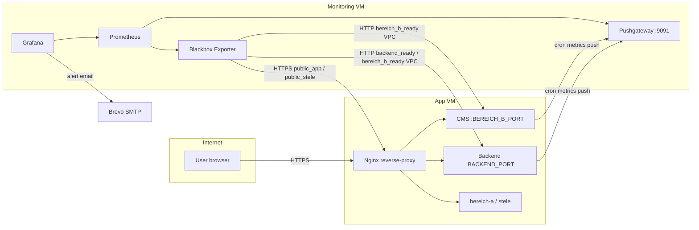
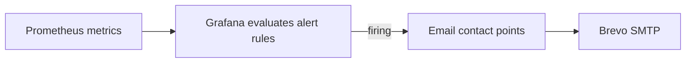

<div align="center">

  <h1>📊 Monitoring Stack</h1>

  <p>
    <b>Observability for the Hameln-Pyrmont Kommunal App</b> <br> HTTP health probes, metrics collection, and Grafana dashboards.
    Runs on a dedicated monitoring VM in production; works locally on macOS with Docker Desktop or Colima.
  </p>

  > **Prerequisites:** For the full developer setup (Task, databases, backend, CMS), see the [root README](../README.md).

  <p>
    
    
    
    
    
  </p>

</div>


## 📚 Table of Contents

- [📁 Folder structure](#-folder-structure)
- [🏗️ Architecture](#️-architecture)
- [🚀 Quick Start (local)](#-quick-start-local)
- [🩺 Health endpoints](#-health-endpoints)
- [🔔 Alerting](#-alerting)
- [⚙️ Configuration](#️-configuration)
- [🔗 Blackbox probe matrix](#-blackbox-probe-matrix)
- [🚢 Production deployment](#-production-deployment)
- [✅ Verification](#-verification)
- [❓ Troubleshooting](#-troubleshooting)
- [📋 Out of scope](#-out-of-scope)

---

## 📁 Folder structure

```text
monitoring/
├── blackbox/blackbox.yml       # Blackbox HTTP probe modules
├── prometheus/
│   ├── prometheus.yml          # Scrape config (incl. blackbox + pushgateway jobs)
│   └── entrypoint.sh           # Generates probe targets from env vars
├── grafana/
│   └── provisioning/           # Datasources, dashboards, alert rules
│       └── alerting/           # rules.json (contact points configured in Grafana UI)
│       ├── dashboards/
│       └── datasources/
├── nginx/reverse-proxy.conf    # TLS proxy for Grafana (production)
├── docker-compose.yml          # Core stack
├── docker-compose.local.yml    # Published ports for local dev
└── .env.example                # Probe targets + secrets template
```

---

## 🏗️ Architecture

| Component | Image | Role |
| :--- | :--- | :--- |
| **Prometheus** | `prom/prometheus:v3.2.1` | Metrics storage, scrapes Blackbox + Pushgateway + self |
| **Pushgateway** | `prom/pushgateway:v1.11.1` | Receives pushed cron job metrics from app VMs |
| **Blackbox Exporter** | `prom/blackbox-exporter:v0.26.0` | HTTP/HTTPS probes (health + public URLs) |
| **Grafana** | `grafana/grafana:11.6.0` | Dashboards, Grafana-managed alerts, email via Brevo SMTP |
| **Nginx + Certbot** | `tls` profile | Grafana TLS in production only |





### Who checks what?

| Component | Dependency readiness | Container up | User-facing availability |
| :--- | :--- | :--- | :--- |
| **Backend** | `GET /health/ready` — Postgres + Gotenberg | cAdvisor (`chore/319-monitoring-agents` branch) | — |
| **CMS (bereich-b)** | `GET /cms/health/ready` — MongoDB ping | cAdvisor (`chore/319-monitoring-agents` branch) | — |
| **bereich-a** | `GET /health/ready` — nginx can reach backend + CMS | cAdvisor (`chore/319-monitoring-agents` branch) | Blackbox `public_app` |
| **Stele** | `GET /health/ready` — nginx can reach backend | cAdvisor (`chore/319-monitoring-agents` branch) | Blackbox `public_stele` |

> ℹ️ Note: There are **no** `/health/live` endpoints. Container liveness is covered by cAdvisor, not duplicate HTTP stubs.

---

## 🚀 Quick Start (local)

App and monitoring run as **separate** Docker Compose projects. Blackbox reaches app processes on the host via `host.docker.internal`.

### 1. Start app dependencies (from repo root)

```bash
task containers:up    # Postgres, MongoDB, Gotenberg
task backend          # http://localhost:5000
task cms              # http://localhost:3001
```

> 💡 Tip: `task start` spins up containers and all services in one go — see [root README](../README.md#-quick-start-guide).

### 2. Configure local probe ports

Copy `.env.example` to `.env` and set native dev ports:

```env
LOCAL_APP_HOST=host.docker.internal
LOCAL_BACKEND_PORT=5000
LOCAL_BEREICH_B_PORT=3001
```

### 3. Start monitoring stack

From this directory (`monitoring/`):

```bash
docker compose -f monitoring/docker-compose.yml \
  -f monitoring/docker-compose.local.yml \
  -p hameln-monitoring up -d
```

**Services & ports (local):**

| Service | URL | Default credentials |
| :--- | :--- | :--- |
| **Grafana** | [http://localhost:3000](http://localhost:3000) | `admin` / `admin` |
| **Prometheus** | [http://localhost:9090](http://localhost:9090) | — |
| **Blackbox** | [http://localhost:9115](http://localhost:9115) | — |

**Stop monitoring:**

```bash
docker compose -f monitoring/docker-compose.yml \
  -f monitoring/docker-compose.local.yml \
  -p hameln-monitoring down
```

| Command | Description |
| :--- | :--- |
| `docker compose … up -d` | Start monitoring stack (local) |
| `docker compose … down` | Stop monitoring stack |
| `docker compose … restart prometheus` | Rebuild probe targets after `.env` changes |

---

## 🩺 Health endpoints

### JSON contract

All application readiness endpoints return:

```json
{ "status": "Healthy", "checks": { "postgres": "Healthy" } }
```

| HTTP status | Meaning |
| :--- | :--- |
| `200` | All checks passed |
| `503` | At least one check failed |

Blackbox module `http_2xx` accepts only `200` — an unhealthy endpoint correctly yields `probe_success 0`.

### Endpoints

| Component | Endpoint | Checks |
| :--- | :--- | :--- |
| **.NET backend** | `/health/ready` | Postgres connection + Gotenberg `/health` |
| **CMS (bereich-b)** | `/cms/health/ready` | MongoDB `ping` |
| **bereich-a** | `/health/ready` | Can reach backend + CMS (`checks.backend`, `checks.cms`) |
| **Stele** | `/health/ready` | Can reach backend (`checks.backend`) |

bereich-a and stele run a **CGI health script** (Option B) inside the nginx container: it `curl`s upstream `/health/ready` endpoints using configured proxy targets (`BACKEND_HOST`, `CMS_UPSTREAM`, `STELE_BACKEND_ORIGIN`).

### Test locally

Ports depend on how you run the app:

| Mode | Backend | CMS | bereich-a | Stele |
| :--- | :--- | :--- | :--- | :--- |
| `task backend` / `task cms` | `:5000` | `:3001` | — (image only) | — (image only) |
| Docker deploy ([`docker/docker-compose.yml`](../docker/docker-compose.yml)) | `:8080` | `:3001` | `:3000` | `:8080` |

> ℹ️ Note: `/health/ready` on bereich-a and stele exists only in the **Docker images**, not in local Vite dev servers.

Internal probes use **HTTP on the VPC private IP** (direct to published container ports).  
Public probes use **HTTPS** on the official domain through the app reverse-proxy.

**curl (native dev):**

```bash
curl -s http://localhost:5000/health/ready | jq
curl -s http://localhost:3001/cms/health/ready | jq
```

**curl (container deploy):**

```bash
curl -s http://localhost:8080/health/ready | jq                              # backend
curl -s http://localhost:3000/health/ready | jq                              # bereich-a
curl -s http://localhost:3001/cms/health/ready | jq                          # CMS
curl -s http://localhost:${STELE_PORT:-8080}/health/ready | jq               # stele
```

**Blackbox (monitoring stack running, `.env` ports set):**

```bash
curl -s 'http://localhost:9115/probe?target=http://host.docker.internal:5000/health/ready&module=http_2xx' | grep probe_success
curl -s 'http://localhost:9115/probe?target=http://host.docker.internal:3001/cms/health/ready&module=http_2xx' | grep probe_success
```

**Prometheus** (after ~15s scrape interval):

```promql
probe_success{job="blackbox"}
probe_duration_seconds{job="blackbox", probe_type="backend_ready"}
probe_http_status_code{job="blackbox"}
(probe_ssl_earliest_cert_expiry{job="blackbox", probe_type=~"public_app|public_stele"} - time()) / 86400
probe_failed_due_to_ssl{job="blackbox", probe_type=~"public_app|public_stele"}
```

Open **Status → Targets** — job `blackbox` lists probes generated at Prometheus startup.

---

## 🔔 Alerting

Grafana-managed alert rules are **provisioned from code** in `grafana/provisioning/alerting/` and sent via Brevo SMTP.

### Provisioned rules (per environment: staging, preprod, production)

| Alert | Condition | Duration |
| :--- | :--- | :--- |
| **Disk** | Root filesystem > 80% | 1 min |
| **CPU** | Average utilization > 95% | 2 min |
| **RAM** | Utilization > 95% | 2 min |
| **Infrastruktur** | One blackbox probe down for the whole 3 minute window (one alert per probe) | 2 min |
| **Cron Job fehlgeschlagen** | Last run of a backend or Bereich B cron job failed | 5 min |
| **SSL ungültig** | Invalid or untrusted certificate on public domain | 5 min |
| **SSL läuft ab** | Certificate expires in < 29 days (warning; Certbot renews at 30) / < 7 days (critical) | 1 h / 15 min |

Edit alert rules in `grafana/provisioning/alerting/rules.json`, or create them in the Grafana UI and export to that folder. **Contact points and notification policies are configured in the Grafana UI only.**

### One-time setup

1. Set `GF_SMTP_*` in `monitoring/.env` (see [`.env.example`](.env.example))
2. Restart Grafana: `docker compose … restart grafana`
3. In Grafana: **Alerting → Contact points** — create an email contact point and use **Test** to verify Brevo delivery
4. **Alerting → Notification policies** — set the default policy (or matchers) to route alerts to that contact point

### Changing rules

1. **Edit in code** — change `grafana/provisioning/alerting/rules.json`
2. **Or use the UI** — create/edit rules in Grafana, export YAML/JSON, commit to `grafana/provisioning/alerting/`
3. Restart Grafana: `docker compose … restart grafana`

Provisioned rules are read-only in the UI. Contact points remain fully editable in the UI.

---

## ⚙️ Configuration

Environment variables are loaded from `monitoring/.env` (copy from [`.env.example`](.env.example)).

| Variable group | Purpose |
| :--- | :--- |
| `GF_*` | Grafana admin user, password, root URL, Brevo SMTP for alert emails |
| `CERTBOT_EMAIL` | Let's Encrypt contact (production TLS bootstrap) |
| `BACKEND_PORT` / `BEREICH_B_PORT` / `BEREICH_A_PORT` / `STELE_PORT` | Shared app ports (staging, preprod, production) |
| `LOCAL_*` | Local Blackbox probe targets (`host.docker.internal`) |
| `STAGING_*` / `PREPROD_*` / `PRODUCTION_*` | Per-environment server IP and public domains |

`prometheus/entrypoint.sh` writes `blackbox.probes.yml` at container start. Empty or invalid URLs are skipped automatically.

> ⚠️ Note: After changing probe env vars, restart Prometheus: `docker compose … restart prometheus`.

---

## 🔗 Blackbox probe matrix

Per environment (`local`, `staging`, `preprod`, `production`):

| `probe_type` | Protocol | Target |
| :--- | :--- | :--- |
| `backend_ready` | HTTP (VPC) | `http://<ip>:<backend-port>/health/ready` |
| `bereich_b_ready` | HTTP (VPC) | `http://<ip>:<bereich-b-port>/cms/health/ready` |
| `bereich_a_ready` | HTTP (VPC) | `http://<ip>:<bereich-a-port>/health/ready` |
| `stele_ready` | HTTP (VPC) | `http://<ip>:<stele-port>/health/ready` |
| `public_app` | HTTPS | `https://<app-domain>/` |
| `public_stele` | HTTPS | `https://<stele-domain>/` |

Public HTTPS probes use the Blackbox module `https_2xx`, which enforces TLS
verification and exposes `probe_ssl_earliest_cert_expiry` (expiry timestamp) and
`probe_failed_due_to_ssl` (invalid certificate).

**Shared app ports** (from `.env.example`, same on all deployed environments):

| | Value |
| :--- | :--- |
| Backend port | `8080` (`BACKEND_PORT`) |
| CMS port | `3001` (`BEREICH_B_PORT`) |
| bereich-a port | `3000` (`BEREICH_A_PORT`, VPC health probes; public traffic uses reverse proxy on `:80`/`:443`) |
| Stele port | `8080` (`STELE_PORT`) |

**Staging domains** (example):

| | Value |
| :--- | :--- |
| App domain | `app.example.invalid` |
| Stele domain | `stele.example.invalid` |

---

## 🚢 Production deployment

Deployed via GitLab CI job `monitoring:deploy`. The job runs on `main` when files under `monitoring/` change. See [`ci/monitoring.gitlab-ci.yml`](../ci/monitoring.gitlab-ci.yml).

**Prerequisites:**

1. DNS A-record: `monitoring.example.invalid` → monitoring VM IP
2. Ports 80 and 443 open on the monitoring VM
3. GitLab environment `monitoring` with `SERVER_IP` set
4. GitLab **File** variable `MONITORING_ENV_FILE` (see `.env.example`)
5. App VMs: firewall allows monitoring VM → `${BACKEND_PORT}`, `${BEREICH_B_PORT}`, `${BEREICH_A_PORT}`, and `${STELE_PORT}` (TCP, VPC only)

<details>
<summary><b>Initial TLS certificate (one-time)</b></summary>

On the monitoring VM after first deploy:

```bash
cd /home/deploy_user/monitoring

docker compose -f docker-compose.yml --profile tls up -d proxy

docker compose -f docker-compose.yml --profile tls run --rm certbot \
  certonly --webroot -w /var/www/certbot \
  -d monitoring.example.invalid \
  --email "$CERTBOT_EMAIL" --agree-tos --no-eff-email

docker compose -f docker-compose.yml --profile tls -p hameln-monitoring --env-file .env up -d
```

</details>

<details>
<summary><b>Manual deploy (without CI)</b></summary>

```bash
docker compose -f docker-compose.yml \
  --profile tls \
  -p hameln-monitoring \
  --env-file .env up -d
```

</details>

---

## ✅ Verification

**Local:**

1. [Grafana](http://localhost:3000) — Prometheus datasource status **green**
2. `docker compose -p hameln-monitoring ps` — prometheus, pushgateway, blackbox, grafana running
3. `probe_success{job="blackbox"}` returns `1` for internal targets when apps are up
4. After a cron job runs with `PUSHGATEWAY_URL` set: `curl -s localhost:9091/metrics | grep cron_job_last_success`

**Production:**

1. [https://monitoring.example.invalid](https://monitoring.example.invalid) — Grafana over valid TLS
2. Prometheus **not** publicly reachable (no exposed ports)
3. `/health/ready` and `/cms/health/ready` reachable on VPC only — not on the public internet

---

## ❓ Troubleshooting

<details>
<summary><b>Blackbox: <code>probe_success 0</code> for local internal targets</b></summary>

**The Problem:**
Blackbox runs inside Docker and probes `host.docker.internal`. If backend/CMS are not running, or ports in `.env` do not match your dev setup, probes fail.

**The Solution:**

1. Confirm apps are up: `curl http://localhost:5000/health/ready` and `curl http://localhost:3001/cms/health/ready`
2. Check `monitoring/.env`: `LOCAL_BACKEND_PORT=5000`, `LOCAL_BEREICH_B_PORT=3001` for `task` workflow
3. Restart Prometheus after `.env` changes: `docker compose … restart prometheus`

</details>

<details>
<summary><b>Prometheus: no blackbox targets listed</b></summary>

**The Problem:**
Probe targets are generated once at Prometheus startup by `entrypoint.sh`. Missing env vars produce an empty target file.

**The Solution:**

1. Verify `LOCAL_APP_HOST` is set (default `host.docker.internal` via `docker-compose.local.yml`)
2. Set at least one valid IP/domain in `.env`
3. Restart Prometheus and check logs: `docker logs hameln-prometheus`

</details>

<details>
<summary><b>Grafana: Prometheus datasource not connected</b></summary>

**The Problem:**
Grafana cannot reach Prometheus on the Docker network.

**The Solution:**

1. Ensure both containers are on `hameln-monitoring` network: `docker compose -p hameln-monitoring ps`
2. Datasource is provisioned from `grafana/provisioning/datasources/prometheus.yml` — URL should be `http://prometheus:9090`
3. Restart Grafana: `docker compose … restart grafana`

</details>

---

## Monitoring agents (app VMs)

Exporters on each app VM are deployed separately. See [agents/README.md](agents/README.md).

---

## 📋 Out of scope

Configure these separately:

- Public homepage body-match probes
- TLS certificate expiry monitoring
